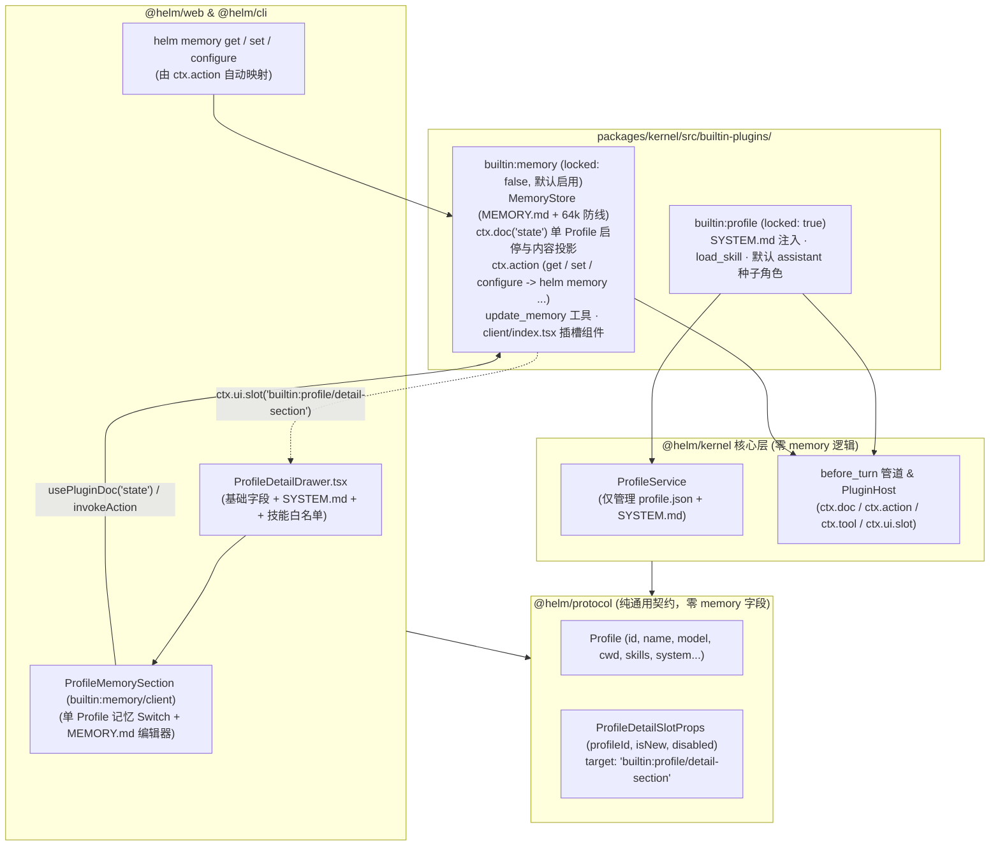

## 背景

Helm 当前将全系统所有 `Profile` 的角色认知装配能力（`SYSTEM.md` 注入、`MEMORY.md` 注入、`<available_skills>` 技能目录注入，以及 `update_memory` / `load_skill` 工具）全部耦合在一个名为 `builtin:assistant`（“个人助理”，`locked: true`）的插件中（`packages/kernel/src/builtin-plugins/assistant.ts`），并且将长期记忆的存储接口硬编码在公共协议包与内核服务中。

这一现状存在四处架构问题：

1. **机制与实例概念错位**：`assistant`（个人助理）只是系统默认预置的一个具体 `Profile` 实例（`~/.helm/profiles/assistant/`），但负责驱动全系统所有 `Profile`（包括 `coder`、`superagent`、`watchdog` 及用户自定义角色）运转的底层插件却被命名为 `builtin:assistant`，注入其他角色的 Prompt Section ID 也带有 `assistant.system`、`assistant.skills` 前缀。
2. **静态角色定义与运行期记忆状态耦合**：`Profile`（`profile.json` + `SYSTEM.md` + `skills`）是静态角色声明（模型只读不写），而长期记忆（`MEMORY.md` 及未来演进的检索/提炼机制）是模型在运行期高频改写的状态子系统。两者绑死在同一个 `locked: true` 插件中，导致用户既无法按单个 `Profile` 关闭记忆，也无法全局停用或独立演进记忆插件。
3. **公共包与内核层残留记忆插件代码**：`@helm/protocol` 的 `Profile` 接口包含 `memory?: string`；`@helm/kernel` 的 `ProfileService`（`packages/kernel/src/services/profiles-skills.ts`）包含 `getMemory`、`updateMemory`、`MAX_MEMORY_CHARS`、`MEMORY_DEFAULT`；`packages/kernel/src/http/routes.ts`、`packages/cli/src/commands/profiles.ts` 与 `packages/web/src/profiles/ProfileDetailDrawer.tsx` 也都硬编码了 `memory` 读写逻辑，违背了“插件代码归口插件自身目录、内核与公共包不依赖具体插件”的原则。
4. **默认提示词硬编码与空白记忆误报**：`packages/kernel/src/services/profiles-skills.ts`（第 47 行）的 `SYSTEM_DEFAULT` 硬编码了 `update_memory` 使用指令；原 `assistant.ts`（第 149 行）把空白 `MEMORY.md`（`!rawMemory.trim()`）当成文件缺失，导致空记忆角色在对话时误报 `<profile_assets_missing>`。

本次设计按“稳定的 `builtin:profile` 底座 + 完全自治的 `builtin:memory` 插件 + 内核/协议零记忆耦合”进行重构，达成以下可观察目标：

- **正名 `builtin:profile`（常驻角色与技能底座，`locked: true`）**：原 `builtin:assistant` 重构为 `builtin:profile`，仅负责全系统 `Profile` 的 `SYSTEM.md` 注入（`profile.system`）、可用技能目录注入（`profile.skills`）、`load_skill` 工具，以及默认种子角色 `assistant` 与系统技能 `helm-cli` 的启动自举。
- **独立且完全自治的 `builtin:memory`（长期记忆插件，`locked: false`，默认启用）**：所有与长期记忆相关的代码（`MemoryStore` 文件读写与 64k 防线、单 `Profile` 记忆开关状态 `ctx.doc`、`before_turn` 注入、`update_memory` 工具、`ctx.action` 动作、Web 单 `Profile` 插槽组件）100% 收归 `packages/kernel/src/builtin-plugins/memory/`。
- **内核与公共包零记忆残留**：从 `@helm/protocol`（`Profile`）、`@helm/kernel`（`ProfileService`、`routes.ts`、`validate.ts`）、`@helm/cli`（`profiles.ts`）和 `@helm/web`（`ProfileDetailDrawer.tsx`、`profile-editor-model.ts`）中彻底移除 `memory` 字段与方法；`ProfileDetailDrawer.tsx` 仅挂载通用子插槽 `<PluginSlot ownerPluginId="builtin:profile" name="builtin:profile/detail-section" />`，由 `builtin:memory` 注入单 `Profile` 级别的记忆开关与编辑器。

非目标：不改变磁盘上每个角色记忆文件 `<dataDir>/profiles/<id>/MEMORY.md` 的物理路径与 64,000 字符上限规则；关闭单 `Profile` 记忆或停用 `builtin:memory` 插件时不删除磁盘已有的 `MEMORY.md` 文件。

建议分支：`refactor/profile-and-memory-plugins`（建议新开分支名，非既有分支）。

---

## 整体设计

本次改造横跨 `@helm/protocol`、`@helm/kernel`、`@helm/web` 与 `@helm/cli` 四个包，保持五包单向依赖方向不变（`web` / `cli` $\rightarrow$ `protocol` $\leftarrow$ `kernel`），且保证 `@helm/protocol` 与 `@helm/kernel` 核心服务层对 `memory` 零感知。



### 职责划分与两级控制语义

1. **`ProfileService`（内核静态角色资产服务）**：仅管理 `~/.helm/profiles/<id>/profile.json` 与 `SYSTEM.md`，不再包含任何 `MEMORY.md` 读写接口。
2. **`builtin:profile`（常驻角色与技能底座，`locked: true`）**：
   - 启动时自举系统内置技能 `helm-cli`（`managedByPlugin: 'builtin:profile'`）与默认种子角色 `assistant`（`id: 'assistant'`，`managedByPlugin: 'builtin:profile'`），并在左栏挂载根会话 `Conversation #1` 置顶项；
   - 在 `before_turn` 读取当前会话 `profileId` 的 `SYSTEM.md` 与可用技能列表，注入 `profile.system`、`profile.skills` 与 `profile.assets-missing`（仅针对 `SYSTEM.md` 缺失），并注册 `load_skill` 工具。
3. **`builtin:memory`（独立长期记忆插件，`locked: false`，默认启用）**：
   - **自管存储（`MemoryStore` + `ctx.doc('state')`）**：内部维护 `MemoryStore`（读写 `<dataDir>/profiles/<profileId>/MEMORY.md`，含文件锁与 `MAX_MEMORY_CHARS = 64_000` 校验），并通过公开文档 `ctx.doc<MemoryPluginDoc>('state', { disabledProfiles: [], memories: {} }, { public: true })` 持久化单 `Profile` 的记忆禁用列表与内容快照。
   - **动作总线（`ctx.action`）**：声明 `get`、`set`、`configure` 三个动作，自动映射为 HTTP `/api/actions/builtin%3Amemory/<action>`、CLI `helm memory get|set|configure` 与前端 `ctx.invokeAction(...)`。
   - **回合注入与工具（`before_turn` + `update_memory`）**：在 `before_turn` 检查当前会话 `profileId` 是否在 `state.disabledProfiles` 中；若已禁用则不注入 `<memory>` 并从 `turn.tools` 中剥离 `update_memory`；在 `update_memory.execute` 入口同样复核单 `Profile` 开关。
   - **Web 插槽组件（`memory/client/index.tsx`）**：通过 `ctx.ui.slot({ target: 'builtin:profile/detail-section' })` 向单 `Profile` 编辑抽屉注入「启用长期记忆」开关与 `MEMORY.md` 编辑器。

单 `Profile` 开关与插件全局状态的行为对照如下表：

| `builtin:memory` 插件状态 | 单角色状态（`disabledProfiles.includes(profileId)`） | `before_turn` `<memory>` 注入 | 该 Profile 会话可见 `update_memory` | 直接调用 `update_memory.execute` | 单 Profile 详情抽屉（`ProfileDetailDrawer`）表现 |
| :--- | :--- | :--- | :--- | :--- | :--- |
| **已启用（默认）** | 未禁用（默认开启） | 注入 `<memory>` 与工具提示 | 可见 | 正常原子写盘（64k 防线） | 插槽渲染「启用长期记忆」Switch（开启）+ `MEMORY.md` 编辑器 |
| **已启用（默认）** | 已禁用（单角色关闭） | 不读取、不注入 | 从本回合 `turn.tools` 剥离（不可见） | 拒绝并抛 `403 memory_disabled_for_profile` | 插槽渲染「启用长期记忆」Switch（关闭），折叠隐藏 `MEMORY.md` 编辑器 |
| **已停用（全局）** | 任意 | 不注入 | 已从宿主卸载（不可见） | 宿主拒绝（`tool_not_found`） | 插槽无贡献项，记忆区块与 `helm memory` CLI 命令同步消失 |

---

## 详细设计

### 1. 协议与内核静态资产层瘦身（零 `memory` 耦合）

#### 1.1 `@helm/protocol`（`packages/protocol/src/assets.ts` & `ui.ts`）

1. **`packages/protocol/src/assets.ts`**：
   - 从 `Profile` 接口中删除 `memory?: string` 字段。
2. **`packages/protocol/src/ui.ts`**：
   - 新增通用角色详情抽屉子插槽常量与 Props 类型（不含任何具体插件业务字段）：
     ```ts
     /** Profile 详情抽屉的插件扩展子插槽全限定名。 */
     export const PROFILE_DETAIL_SECTION_SLOT = 'builtin:profile/detail-section' as const

     /** target: 'builtin:profile/detail-section' 子插槽传递给插件 client.tsx 组件的通用 Props。 */
     export interface ProfileDetailSlotProps {
       /** 当前正在查看/编辑的单个 Profile ID。 */
       profileId: string
       /** 是否处于新建 Profile 模式（尚未创建落盘）。 */
       isNew: boolean
       /** 宿主抽屉是否处于保存或删除中的禁用态。 */
       disabled: boolean
     }
     ```

#### 1.2 `@helm/kernel` 核心层（`ProfileService` & HTTP 路由校验）

1. **`packages/kernel/src/services/profiles-skills.ts`**：
   - 删除 `MAX_MEMORY_CHARS`、`MEMORY_DEFAULT`、`memoryLimitError`、`ProfileService.getMemory`、`ProfileService.updateMemory`；
   - `ProfileService.ensureDefault` 与 `ProfileService.save` 仅负责读写 `profile.json` 与 `SYSTEM.md`，不再读写 `MEMORY.md`；
   - 从 `SYSTEM_DEFAULT` 中移除第 4 条 `4. 用 update_memory 保存稳定的用户偏好与约定。`；
   - 保持 `packages/kernel/src/services/fs-atomic.ts` 中的 `withFileLock`、`atomicWriteFile`、`readTextOrThrow` 供内核与内置插件共用。
2. **`packages/kernel/src/http/routes.ts` & `validate.ts`**：
   - `routes.ts` 的 `enrichProfile` 仅读取 `const system = await kernel.profiles.getSystem(profile.id)` 并返回 `{ ...profile, system }`；
   - `validate.ts` 的 `parseProfileBody` 白名单移除 `'memory'`。

### 2. `builtin:profile` 插件（原 `builtin:assistant` 重构）

删除 `packages/kernel/src/builtin-plugins/assistant.ts` 与 `assistant/`，新建 `packages/kernel/src/builtin-plugins/profile.ts` 与 `profile/assets.ts`：

- **插件标识與导出**：
  - `id: 'builtin:profile'`，`name: '角色与技能底座'`，`version: '0.1.0'`，`locked: true`；
  - 导出 `PROFILE_PLUGIN_ID = 'builtin:profile'`、`PROFILE_MANAGED_BY = 'builtin:profile'`、`HELM_CLI_SKILL_ID = 'helm-cli'`、`HELM_CLI_SKILL_ASSET`、`createProfilePlugin`。
- **启动自举服务（`profile-bootstrap`）**：
  - 调用 `skills.ensureSkill(HELM_CLI_SKILL_ASSET)` 同步内置技能 `helm-cli`（`managedByPlugin: 'builtin:profile'`）；
  - `ensureDefaultProfileManaged(profiles)`：若默认角色 `assistant` 的 `managedByPlugin` 为 `undefined` 或旧值 `'builtin:assistant'`，更新为 `'builtin:profile'`。
- **`before_turn` 钩子**：
  - 读取 `profiles.getSystem(profileId)` 与经 `profile.skills` 白名单过滤后的可用技能列表；
  - 按 `profileId` 独立去重追踪 `SYSTEM.md` 缺失通知（`missingNotified = new Set<string>()`）；
  - 注入段落 ID 正名为：`profile.system`、`profile.assets-missing`、`profile.skills`。
- **工具与导航**：
  - 注册 `load_skill` 工具；
  - 注册 `ctx.ui.sidebarItem({ id: 'assistant', label: '个人助理', icon: 'sparkles', target: 'conversation:1', order: 0 })`。

### 3. `builtin:memory` 插件（完全自治实现）

所有长期记忆代码集中在 `packages/kernel/src/builtin-plugins/memory.ts`、`memory/store.ts` 与 `memory/client/index.tsx`。

#### 3.1 `MemoryStore` 与状态模型（`packages/kernel/src/builtin-plugins/memory/store.ts`）

`MemoryStore` 直接管理 `<dataDir>/profiles/<profileId>/MEMORY.md` 文件，复用 `fs-atomic.ts` 的 `withFileLock`、`atomicWriteFile` 与 `readTextOrThrow`：

```ts
export const MEMORY_PLUGIN_ID = 'builtin:memory' as const
export const MAX_MEMORY_CHARS = 64_000
export const MEMORY_DEFAULT = ['# Memory', '', ''].join('\n')

export interface MemoryPluginDoc {
  /** 已关闭长期记忆的 Profile ID 列表（不在列表中的 Profile 默认开启）。 */
  disabledProfiles: string[]
  /** 各 Profile 的记忆内容缓存快照（供 Web 抽屉插槽实时读取）。 */
  memories: Record<string, string>
}

export function isProfileMemoryEnabled(
  doc: Pick<MemoryPluginDoc, 'disabledProfiles'> | undefined,
  profileId: string,
): boolean {
  return !(doc?.disabledProfiles ?? []).includes(profileId)
}
```

`MemoryStore` 方法契约：

- `ensureMemory(profileId: string): Promise<string>`：在文件锁内检查 `<dataDir>/profiles/<profileId>/MEMORY.md`，若不存在则写入 `MEMORY_DEFAULT`（`# Memory\n\n`），返回当前全文。
- `getMemory(profileId: string): Promise<string>`：读取 `<dataDir>/profiles/<profileId>/MEMORY.md`；若文件不存在抛出 `FileNotFoundError`。
- `hasMemoryFile(profileId: string): boolean`：检查 `<dataDir>/profiles/<profileId>/MEMORY.md` 是否存在。
- `updateMemory(profileId: string, text: string, mode: 'append' | 'replace' = 'append', options?: { maxChars?: number }): Promise<string>`：在 `<dataDir>/profiles/<profileId>/MEMORY.md` 的文件锁内执行追加或替换；当 `options?.maxChars` 存在且合并后总长度超过上限时，抛出 `HelmError('memory_limit_exceeded', ..., 400)` 且不写盘。

#### 3.2 插件主入口：`ctx.doc`、`ctx.action`、`before_turn`、`update_memory`（`memory.ts`）

1. **公开状态文档**：
   ```ts
   const stateDoc = ctx.doc<MemoryPluginDoc>(
     'state',
     { disabledProfiles: [], memories: {} },
     { public: true },
   )
   ```
2. **启动初始化服务（`memory-bootstrap`）**：
   - 在 `start()` 中确保默认角色 `assistant`（若未被禁用且目录存在）拥有初始 `MEMORY.md` 文件，并扫描现有 `profiles.list()`，将磁盘已存在的 `MEMORY.md` 读入 `stateDoc.memories` 字典中。
3. **三个插件动作 `ctx.action`（自动映射为 `helm memory get|set|configure` CLI 命令与 HTTP 端点）**：
   - **`get`**：
     - `inputSchema`：`{ type: 'object', properties: { profileId: { type: 'string', minLength: 1 } }, required: ['profileId'], additionalProperties: false }`
     - 行为：校验 `assertProfileId(input.profileId)`；读取 `enabled = isProfileMemoryEnabled(stateDoc.get(), input.profileId)`；若磁盘存在 `MEMORY.md` 则读取全文（不存在则为空串 `""`），同步写入 `stateDoc.memories[input.profileId]` 并返回 `{ profileId, enabled, content }`。
   - **`set`**：
     - `inputSchema`：`{ type: 'object', properties: { profileId: { type: 'string', minLength: 1 }, text: { type: 'string' }, mode: { type: 'string', enum: ['replace', 'append'] } }, required: ['profileId', 'text'], additionalProperties: false }`
     - 行为：校验 `await profiles.get(input.profileId)` 存在（不存在抛 `404 profile_not_found`）；调用 `store.updateMemory(input.profileId, input.text, input.mode ?? 'replace', { maxChars: MAX_MEMORY_CHARS })`，同步更新 `stateDoc.memories[input.profileId]`，返回 `{ profileId, updated: true, length: written.length }`。
   - **`configure`**：
     - `inputSchema`：`{ type: 'object', properties: { profileId: { type: 'string', minLength: 1 }, enabled: { type: 'boolean' }, text: { type: 'string' } }, required: ['profileId', 'enabled'], additionalProperties: false }`
     - 行为：校验 `await profiles.get(input.profileId)` 存在；更新 `stateDoc` 中的 `disabledProfiles`（`enabled: true` 移除该 `profileId`，`enabled: false` 去重加入）；若 `input.text !== undefined` 则同步调用 `store.updateMemory(input.profileId, input.text, 'replace', { maxChars: MAX_MEMORY_CHARS })`；若 `enabled: true` 且该角色尚无 `MEMORY.md` 文件，调用 `store.ensureMemory(input.profileId)` 初始化文件；返回 `{ profileId: input.profileId, enabled: input.enabled }`。
4. **`before_turn` 钩子**：
   - 获取当前会话 `const profileId = turn.conversation.profileId`；
   - **当 `!isProfileMemoryEnabled(stateDoc.get(), profileId)`（单角色已关闭记忆）**：
     - 不读取 `MEMORY.md`，不注入任何记忆段落；
     - 从 `turn.tools` 中过滤掉 `name === 'update_memory'`，返回 `{ kind: 'transform', value: { sections: turn.sections, messages: turn.messages, tools: turn.tools.filter((t) => t.name !== 'update_memory') } }`。
   - **当 `isProfileMemoryEnabled(stateDoc.get(), profileId)`（单角色已开启记忆）**：
     - 读取 `store.getMemory(profileId)`：
       - **读取成功**：`missingNotified.delete(profileId)`。若 `rawMemory.trim()` 非空，按 `MAX_MEMORY_CHARS` 截断后注入 `{ id: 'memory.content', text: '<memory>\n...\n</memory>\n用 `update_memory` 保存稳定的用户偏好与约定。' }`；若为空白内容，仅注入 `{ id: 'memory.guide', text: '用 `update_memory` 保存稳定的用户偏好与约定。' }`。
       - **捕获 `FileNotFoundError`**：
         - 若该 `profileId` 是首次创建的自定义角色且尚未初始化过 `MEMORY.md`（未在 `initializedProfiles` 集合中），自动调用 `await store.ensureMemory(profileId)` 初始化默认 `MEMORY.md` 并注入 `memory.guide`（避免新建角色首次对话误报缺失）；
         - 若该 `profileId` 的 `MEMORY.md` 曾存在但被外部物理删除，按 `profileId` 独立去重发送 `warning` 通知（`title: "长期记忆文件缺失：<profileId>/MEMORY.md"`），并注入 `{ id: 'memory.assets-missing', text: '<profile_assets_missing>\n[警告] 长期记忆资产缺失（<profileId>/MEMORY.md）；请提醒用户检查 ~/.helm/profiles/ 目录或通过 update_memory 重建。\n</profile_assets_missing>' }`。
5. **`update_memory` 工具**：
   - 在 `execute(input, context)` 中先检查 `isProfileMemoryEnabled(stateDoc.get(), profileId)`：若为 `false`，抛出 `HelmError('memory_disabled_for_profile', "Profile '<profileId>' 已关闭长期记忆，禁止调用 update_memory", 403, { profileId })`；
   - 否则调用 `const content = await store.updateMemory(profileId, input.text, input.mode, { maxChars: MAX_MEMORY_CHARS })`，同步更新 `stateDoc.memories[profileId] = content`，返回 `{ updated: true, profileId }`。

#### 3.3 单 Profile 抽屉插槽组件（`packages/kernel/src/builtin-plugins/memory/client/index.tsx`）

`builtin:memory` 注册插槽：

```ts
ctx.ui.slot({
  id: 'profile-memory-section',
  target: PROFILE_DETAIL_SECTION_SLOT,
  order: 10,
  client: { module: 'index.tsx', export: 'ProfileMemorySection' },
})
```

`ProfileMemorySection` 组件接收 `ProfileDetailSlotProps`（`{ profileId, isNew, disabled }`），通过 `@helm/plugin-client` 的 `usePluginContext()` 与 `usePluginDoc<MemoryPluginDoc>('state')` 闭环工作：

- **新建角色模式（`isNew === true`）**：渲染 `.section-flat` 区块，提示“保存并创建角色后，可在此开启或关闭该角色的长期记忆并编辑 MEMORY.md。”
- **编辑已有角色模式（`isNew === false && profileId`）**：
  - 组件挂载或 `profileId` 切换时调用 `ctx.invokeAction('get', { profileId })` 同步最新记忆内容；
  - 头部右侧提供单角色 Switch 开关（「启用长期记忆」，`checked = !(doc?.disabledProfiles ?? []).includes(profileId)`），点击时调用 `ctx.invokeAction('configure', { profileId, enabled: !checked })`；
  - 开启时展示 `MEMORY.md` `<textarea>` 与「保存记忆」按钮（当本地草稿相对 `doc?.memories[profileId]` 有修改时可点击，调用 `ctx.invokeAction('set', { profileId, text: draft, mode: 'replace' })`）；
  - 关闭时折叠隐藏 `<textarea>`，展示“已为此角色关闭长期记忆，对话中不会注入 MEMORY.md，也不会暴露 update_memory 工具。”

### 4. Web 宿主与 CLI 清理

1. **`packages/web/src/profiles/ProfileDetailDrawer.tsx`**：
   - 从 `FormState`、`createInitialForm`、`isDirty`、`handleSave` 中移除 `memory` 字段；
   - 移除 `handleSave` 中后端 `parseProfileBody` 不支持的 `description` 与 `defaultModel` 键；
   - 将硬编码的「长期记忆 (MEMORY.md)」`<section>` 替换为：
     ```tsx
     <PluginSlot
       ownerPluginId="builtin:profile"
       name={PROFILE_DETAIL_SECTION_SLOT}
       slotProps={{
         profileId: form.id.trim(),
         isNew,
         disabled: isSaving || isDeleting,
       }}
     />
     ```
2. **`packages/web/src/modals/profile-editor-model.ts` & `packages/web/src/profiles/profile-center-model.ts`**：
   - 移除 `memory` 相关字段处理。
3. **`packages/web/src/plugins/PluginCard.tsx` & `plugin-center-model.ts`**：
   - 将 `builtin:assistant` 更新为 `builtin:profile`（角色与技能底座），新增 `builtin:memory`（长期记忆：管理各 Profile 的 MEMORY.md 长期记忆注入、单角色记忆启停与 `update_memory` 工具）。
4. **`packages/cli/src/commands/profiles.ts`**：
   - 移除 `--memory` 与 `--memory-file` 选项及 `delete base['memory']` 逻辑（记忆操作由 `builtin:memory` 的 `ctx.action` 自动生成 `helm memory get / set / configure` 命令）。

---

## 影响分析

- **插件 ID 正名（`builtin:assistant` $\rightarrow$ `builtin:profile`）与 `builtin:memory` 拆分**：
  - `packages/kernel/src/app.ts`：注册 `createProfilePlugin(kernel)` 与 `createMemoryPlugin(kernel)`；
  - `packages/kernel/src/index.ts`：导出 `createProfilePlugin` 与 `createMemoryPlugin`（替代原 `createAssistantPlugin`）；
  -Prompt Section ID 变更：原 `assistant.system` / `assistant.skills` / `assistant.assets-missing` 变为 `profile.system` / `profile.skills` / `profile.assets-missing`；原 `assistant.memory` 变为 `memory.content` / `memory.guide` / `memory.assets-missing`。
- **API 与 CLI 同权**：
  - `builtin:memory` 通过 `ctx.action` 声明 `get`、`set`、`configure` 后，自动暴露 HTTP `POST /api/actions/builtin%3Amemory/{get,set,configure}` 与 CLI `helm memory {get,set,configure}`（支持 `--json`），停用插件后命令自动卸载。

---

## 发布与恢复

本次改造不涉及 SQLite 表结构变更：

- **单 Profile 级启停与恢复**：通过 Web 角色详情抽屉的「启用长期记忆」开关或 `helm memory configure --profile-id <id> --enabled false` 即时关闭指定角色的记忆；已有的 `~/.helm/profiles/<id>/MEMORY.md` 文件保留在磁盘上，重新执行 `--enabled true` 即可恢复。
- **全局插件级启停与恢复**：通过插件中心或 `helm plugins disable builtin:memory` / `helm plugins enable builtin:memory` 全局停用或启用长期记忆能力。

---

## 测试

所有测试命令均带超时保护（`timeout 50s pnpm test`）：

| 编号 | 场景 | 前置条件与输入 | 目标路径 | 预期可观察结果 |
| :--- | :--- | :--- | :--- | :--- |
| **T1** | **`builtin:profile` 与 `builtin:memory` 默认协同** | 全新数据目录启动 `createHelm()`，在根会话 `#1` 发起回合 | `builtin:profile.onBeforeTurn` + `builtin:memory.onBeforeTurn` | 插件列表含 `builtin:profile`（`locked: true`）与 `builtin:memory`（`locked: false, enabled: true`）；Sections 含 `profile.system`、`profile.skills` 与 `memory.content`（或 `memory.guide`） |
| **T2** | **单 Profile 关闭长期记忆** | 调用 `builtin:memory` 的 `configure` 动作将 `coder` 设为 `enabled: false`；分别在 `coder` 会话与 `assistant` 会话发起回合 | `builtin:memory.onBeforeTurn` | `coder` 会话无 `<memory>` 注入且 `turn.tools` 不含 `update_memory`；`assistant` 会话正常注入 `<memory>` 且含 `update_memory` |
| **T3** | **单 Profile 关闭记忆时的工具执行期拦截** | `coder` 已设为 `enabled: false`；直接调用 `executeTool('update_memory', ...)` | `builtin:memory` `update_memory.execute` | 抛出 `HelmError`（`403 memory_disabled_for_profile`），磁盘不写入 |
| **T4** | **全局停用 `builtin:memory` 插件** | 调用 `host.disable('builtin:memory')` 后发起回合 | `PluginHost.disable` | 所有会话均无 `<memory>` 注入，`update_memory` 工具与 `helm memory` 动作卸载；`builtin:profile` 的 `SYSTEM.md` 与 `load_skill` 正常工作 |
| **T5** | **`MemoryStore` 64k 上限防线与并发文件锁** | 并发调用 `updateMemory` 追加内容逼近 `MAX_MEMORY_CHARS`（64,000） | `MemoryStore.updateMemory` | 超出上限的调用显式抛 `400 memory_limit_exceeded`，最终文件长度严格 $\le 64,000$ |
| **T6** | **空白记忆合法状态 vs 物理文件被删告警** | Profile A 的 `MEMORY.md` 为空白；Profile B 已存在的 `MEMORY.md` 从磁盘删除；分别发起回合 | `builtin:memory.onBeforeTurn` | Profile A 不发通知、不报缺失；Profile B 触发一次 warning 通知并注入 `memory.assets-missing` |
| **T7** | **Web 单 Profile 抽屉 `<PluginSlot />` 与 `helm memory` CLI 同权** | 渲染 `ProfileDetailDrawer` 并通过 CLI 执行 `helm memory configure / set / get --json` | `ProfileDetailDrawer` $\rightarrow$ `ProfileMemorySection` & CLI 动态插件命令 | Web 抽屉通过 `builtin:profile/detail-section` 插槽渲染单 Profile 记忆开关与编辑器；CLI `helm memory` 命令正常读写并控制单角色记忆开关 |

---

## 实现勘误（2026-11-10 worktree 落地版）

本文按最终落地实现修正两处设计细节（主代理纠偏，落地以此为准）：

1. **记忆全文不进公共文档**：磁盘 `<dataDir>/profiles/<id>/MEMORY.md` 是全文唯一权威；插件私有 `ctx.doc('state')` 只持久化 `disabledProfiles` 与 `initializedProfiles` 两份紧凑状态，**不含 `memories` 全文快照**，也不进入全局首帧或 SSE 广播。Web 端经 `get` 动作按需读取当前 Profile 的内容与开关并显示真实错误，避免双写全文与全局广播写放大。
2. **初始化与删除缺失区分跨重启成立**：`initializedProfiles` 为持久化标记（非进程内 Set）——从未初始化的合法 Profile 首次需要记忆时惰性创建默认文件（不误报缺失）；已初始化后被外部删除则显式 warning + `memory.assets-missing` 段落，**绝不启动时无条件重建掩盖丢失**；空白文件是合法 `memory.guide` 态；文件恢复或工具写入后自愈。

另：本轮同分支合并落地「初始会话 `#1` 特殊设计移除」（删除保护、导航硬编码、trigger 缺省依赖与 `ROOT_CONVERSATION_ID` 公共契约），详见 `AGENTS.md` 与 `docs/plugins/profile.md` / `docs/plugins/memory.md`。
