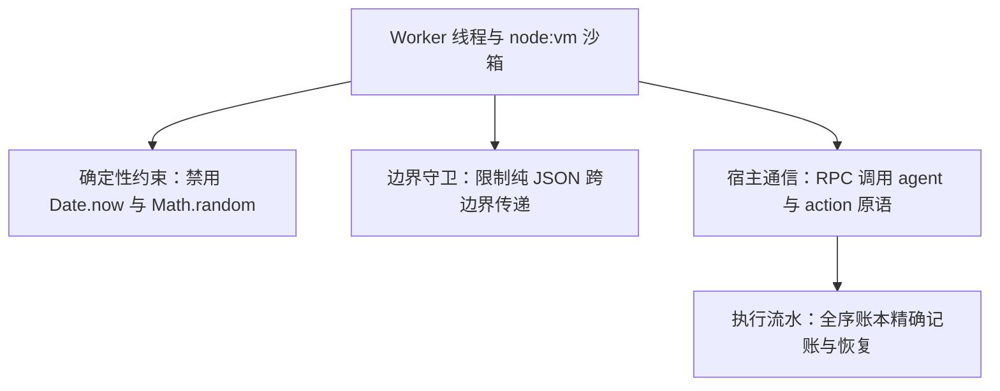

# 原生 JavaScript 编排 DSL 手册

本文介绍 Helm 原生 JavaScript 编排 DSL 的语法规范与执行机制。

---

## 编排架构与设计理念

Helm 采用原生 JavaScript 作为工作流编排 DSL。
脚本执行在独立的 Worker 线程与 `node:vm` 上下文中。
这种设计具备三大核心特征：



1. **逻辑确定性**：禁用动态代码生成与非确定性 API。
2. **状态可恢复**：所有副作用通过 RPC 交付宿主统一记账。
3. **零额外学习成本**：直接使用标准 JavaScript 语言特性。

---

## 脚本结构与元数据声明

每个工作流脚本由顶部静态元数据和执行逻辑组成。

### 1. 元数据对象 (`meta`)

脚本顶部必须通过字面量导出 `meta` 对象。
内核在求值前通过静态扫描提取该对象。

```javascript
export const meta = {
  name: "code-review-pipeline",
  description: "多维度代码审查与自动化门禁流水线",
  whenToUse: "当需要对拉取请求进行全面静态分析与测试时使用",
  phases: [
    { title: "准备工作区", detail: "拉取代码并准备独立环境" },
    { title: "并行审查", detail: "多维度并行分析代码" },
    { title: "汇总报告", detail: "聚合分析结果并输出建议" },
  ],
}
```

#### 元数据字段规范

| 字段 | 类型 | 是否必填 | 说明 |
| :--- | :--- | :--- | :--- |
| `name` | `string` | 是 | 工作流唯一标识符 |
| `description` | `string` | 是 | 工作流功能描述 |
| `whenToUse` | `string` | 否 | 适用场景说明 |
| `phases` | `WorkflowPhaseMeta[]` | 否 | 阶段声明列表，用于界面预渲染 |

> [!IMPORTANT]
> `meta` 必须是纯静态字面量。
> 禁止在 `meta` 中使用变量、函数调用、扩展运算符或模板插值。
> 违规声明会导致解析抛出异常并拒绝执行。

### 2. 动态输入参数 (`args`)

外部传入的参数通过全局变量 `args` 访问。
通过 CLI 传入 JSON 字符串：

```bash
helm workflows run ./review.js --args '{"pr": 1024, "strict": true}'
```

在脚本内部直接读取：

```javascript
const prId = args?.pr ?? 0
const isStrict = Boolean(args?.strict)
log(`开始处理拉取请求 #${prId}`)
```

---

## 沙箱内置原语参考

执行沙箱为脚本注入了一组异步原语。

### 1. `agent(prompt, options)`

调度子智能体执行推理或工具调用任务。

#### 调用参数

- `prompt` (`string`)：提示词文本，必须是非空字符串。
- `options` (`object`)：可选配置项对象。

| 配置项 | 类型 | 说明 |
| :--- | :--- | :--- |
| `label` | `string` | 任务展示标题 |
| `phase` | `string` | 所属阶段名称 |
| `model` | `string` | 指定使用的模型标识 |
| `agentType` | `string` | 指定 Profile ID 或外部执行环境标识 |
| `isolation` | `'worktree'` | 启用独立 Git Worktree 隔离 |
| `gate` | `string` | 自动化代码门禁验收命令 |
| `resume` | `string` | 续接的历史智能体会话标识 |
| `effort` | `string` | 推理思考级别 |
| `schema` | `object` | 结构化输出的 JSON Schema 规范 |

`effort` 可选值包括：`minimal`、`low`、`medium`、`high`、`xhigh`、`max`。

#### 选项互斥规则

- `resume` 与 `agentType` 互斥。续接会话保持原类型。
- `resume` 与 `model` 互斥。续接会话保持原模型。
- `resume` 与 `isolation` 互斥。续接会话保持原工作目录。
- `resume` 与 `effort` 互斥。续接会话保持原思考配置。
- `resume` 允许与 `schema` 和 `gate` 组合使用。

#### 结构化输出 (`schema`)

当配置 `schema` 时，宿主自动挂载结构化契约。
子智能体会严格返回符合 Schema 的 JSON 字符串。
引擎完成解析后返回 JavaScript 原生对象：

```javascript
const result = await agent("提取提交信息中的修改范围与风险点", {
  schema: {
    type: "object",
    properties: {
      scope: { type: "string" },
      riskLevel: { type: "string", enum: ["low", "medium", "high"] },
      summary: { type: "string" },
    },
    required: ["scope", "riskLevel", "summary"],
  },
})

log(`范围: ${result.scope}, 风险: ${result.riskLevel}`)
```

若子智能体输出无法满足契约，返回 `null`。

### 2. `parallel(thunks)`

并发执行多个无依赖的异步任务。

- `thunks`：无参异步函数数组，例如 `[() => taskA(), () => taskB()]`。
- 容错语义：单个任务普通异常自动转为 `null`，不中断其余任务。
- 致命异常：超出系统配额或账本失效时抛出异常。
- 返回值：按原数组顺序返回每个任务的结算结果。

```javascript
const [security, perf] = await parallel([
  () => agent("审查代码安全隐患", { label: "安全审计" }),
  () => agent("分析算法性能瓶颈", { label: "性能分析" }),
])
```

### 3. `pipeline(items, ...stages)`

流水线式按阶段处理数据数组。

- `items`：待处理数据项列表。
- `stages`：顺序处理函数序列。每个阶段接收 `(value, item, index)`。
- 容错语义：某个阶段失败返回 `null`，跳过该项后续阶段。
- 返回值：最终处理完成的结果数组。

```javascript
const files = ["src/a.ts", "src/b.ts"]

const reports = await pipeline(
  files,
  async (file) => {
    return await agent(`检查文件语法: ${file}`)
  },
  async (syntaxReport, file) => {
    return await agent(`基于语法报告优化代码: ${syntaxReport}`)
  }
)
```

### 4. `phase(title)`

声明进入指定业务阶段。

```javascript
phase("架构分析")
await agent("分析系统模块依赖关系")
```

调用 `phase()` 后，后续调用的 `agent()` 和 `action()` 自动归入该阶段。
若 `agent()` 自身指定了 `options.phase`，以自身选项为准。

### 5. `log(message)`

向工作流执行时间线输出日志记录。

```javascript
log("开始执行依赖安全性扫描")
```

日志会自动附带当前作用域前缀与阶段标识。

### 6. `action(id, input)`

零 Token 确定性调用 Helm 插件注册的动作能力。

- `id` (`string`)：插件动作标识符，格式为 `pluginId:actionName`。
- `input` (`object`)：传给动作的输入参数对象。
- 特性：不消耗模型 Token，执行结果记入确定性流水账本。

```javascript
const result = await action("builtin:git:diff", {
  base: "main",
  head: "feature",
})
```

### 7. `workflow(ref, args)`

嵌套调用其他已保存的工作流。

- `ref`：工作流名称字符串，或 `{ scriptPath: string }` 对象。
- `args`：传递给子工作流的输入参数。
- 嵌套限制：最大嵌套深度为 1。禁止多层嵌套调用。

```javascript
const subResult = await workflow("lint-subflow", { target: "packages/core" })
```

### 8. `console` 与 `budget`

沙箱提供辅助全局对象：

- `console.log(...)`：格式化输出内容并转为时间线日志。
- `budget.spent()`：获取当前工作流已消耗的模型输出 Token 数量。
- `budget.remaining()`：查询剩余 Token 配额。

---

## 确定性保证与沙箱安全约束

为了保证断点续跑和重放一致性，沙箱施加了确定性限制。

### 1. 禁用非确定性时钟与随机数

沙箱在代码执行前注入了确定性前导垫片：

- 拒绝 `Date.now()`：抛出明确异常。
- 拒绝 `Math.random()`：抛出明确异常。
- 拒绝无参数 `new Date()`：抛出明确异常。
- 允许带参数 `new Date(timestamp)`：解析确定时间。

> [!TIP]
> 如果工作流需要时间戳，请通过 `args` 外部传入。
> 也可以在工作流返回后由宿主统一记录时间。

### 2. 严格 JSON 数据边界

所有跨越沙箱边界的输入输出必须是合法的 JSON 数据。
引擎会对数据执行深度递归检查，拒绝以下非法类型：

1. `undefined`（工作流根返回值允许返回 undefined）。
2. `BigInt` 与 `Symbol`。
3. `Function` 与非有限数值（`NaN`、`Infinity`）。
4. 稀疏数组与包含 Symbol 键的对象。
5. 非普通对象（具有自定义原型链的实例）。
6. 循环引用对象结构。

### 3. 执行配额上限

系统配置了硬性资源配额防止意外挂死：

| 配额项 | 常量定义 | 上限阈值 |
| :--- | :--- | :--- |
| 脚本源码长度 | `MAX_SCRIPT_LENGTH` | 512 KB |
| 单次执行 Agent 总数 | `WORKFLOW_AGENT_CAP` | 1000 个 |
| 单次列表项容量 | `WORKFLOW_ITEM_CAP` | 4096 项 |
| 嵌套工作流调用次数 | `WORKFLOW_NESTED_CAP` | 256 次 |

---

## 完整实战范例

下面是一个包含多原语组合的完整代码审查工作流：

```javascript
export const meta = {
  name: "comprehensive-audit",
  description: "结合 Worktree 沙箱、并行审查与门禁的完整流程",
  phases: [
    { title: "环境准备" },
    { title: "并行审查" },
    { title: "门禁验证" },
    { title: "总结报告" },
  ],
}

// 1. 读取外部参数
const targetBranch = args?.targetBranch ?? "main"
log(`开始针对分支 ${targetBranch} 执行审计`)

// 2. 阶段一：环境准备与差异提取
phase("环境准备")
const diffSummary = await action("builtin:git:diff_stat", {
  target: targetBranch,
})

// 3. 阶段二：并行多维度代码审查
phase("并行审查")
const [securityFinding, styleFinding] = await parallel([
  () => agent(`审查以下提交的代码安全隐患:\n${JSON.stringify(diffSummary)}`, {
    label: "安全审查",
    effort: "high",
    schema: {
      type: "object",
      properties: {
        vulnerabilities: { type: "array", items: { type: "string" } },
        score: { type: "number" },
      },
      required: ["vulnerabilities", "score"],
    },
  }),
  () => agent(`审查代码架构与设计规范:\n${JSON.stringify(diffSummary)}`, {
    label: "架构审查",
    effort: "medium",
  }),
])

// 4. 阶段三：沙箱隔离修复与门禁验证
phase("门禁验证")
const fixResult = await agent("修复安全审查中发现的严重漏洞并验证测试", {
  label: "自动化修复",
  isolation: "worktree",
  gate: "pnpm test",
})

// 5. 阶段四：汇总成果
phase("总结报告")
const finalReport = await agent("整理各阶段发现，生成最终审查简报", {
  label: "报告汇总",
  schema: {
    type: "object",
    properties: {
      approved: { type: "boolean" },
      summary: { type: "string" },
    },
    required: ["approved", "summary"],
  },
})

log(`审计完成，批准状态: ${finalReport.approved}`)
return {
  security: securityFinding,
  style: styleFinding,
  fix: fixResult,
  verdict: finalReport,
}
```
