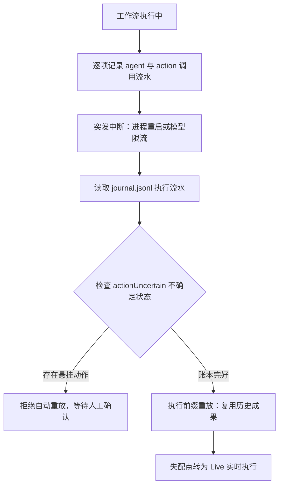
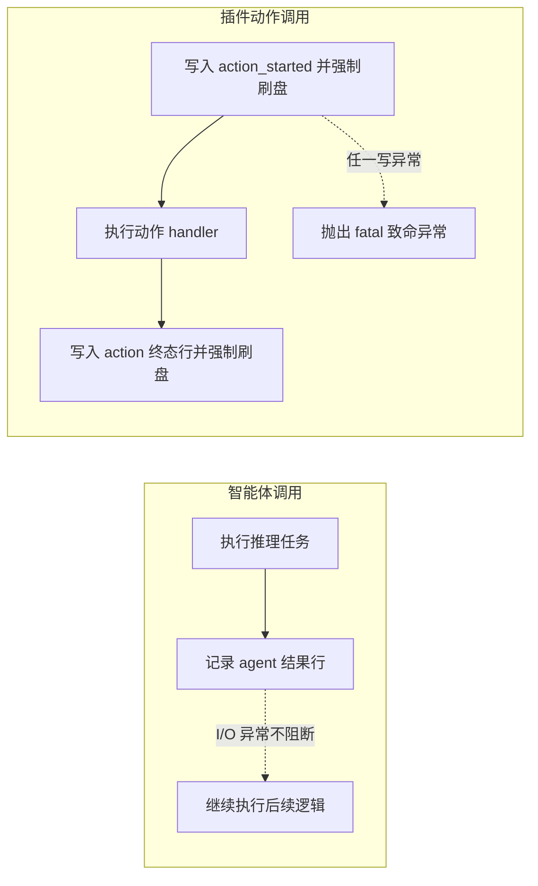

# 确定性执行流水与异常恢复

本文介绍 Helm 确定性执行流水（Journaling）、前缀重放与异常恢复机制。

---

## 为什么需要确定性执行流水

长链路多智能体编排面临网络超时、进程重启或模型限流等意外中断。
传统系统只能整体从头重跑任务，浪费大量 Token 与时间。

Helm 采用确定性执行流水方案：



1. **精准记账**：每一步调用按序记录到独立流水文件中。
2. **前缀复用**：恢复时跳过已成功的前缀节点，零 Token 消耗。
3. **副作用保护**：严格保证动作副作用恰好一次，绝不盲目重复调用。

---

## 执行流水存储与事件契约

每个工作流任务拥有专属的 `journal.jsonl` 流水文件。
存储路径位于 `~/.helm/workflows/runs/<runId>/journal.jsonl`。

### 1. 事件行类型

流水文件包含三类核心事件行：

| 事件类型 (`type`) | 适用场景 | 核心字段 |
| :--- | :--- | :--- |
| `agent` | 智能体调用终态 | `index`, `key`, `ok`, `text`, `seq` |
| `action_started` | 动作调用意图 | `index`, `key`, `seq` |
| `action` | 动作调用终态 | `index`, `key`, `ok`, `result`, `error`, `seq` |

- `index`：本次执行中的调用发起次序。智能体与动作共享全序。
- `seq`：落盘物理单调序号，用于并发写入后稳定排序。
- `key`：调用参数载荷的哈希摘要，保证输入一致性。

### 2. 载荷哈希计算

系统通过 SHA-256 算法生成唯一调用 Key：

- **智能体 Key**：涵盖 `prompt`、`label`、`model`、`agentType`、`effort`、`isolation`、`gate`、`resume` 与 `schema`。
- **动作 Key**：涵盖全限定 `actionId` 与序列化后的输入对象。

任何参数微调都会改变 Key，防止误用过期缓存。

---

## 前缀重放机制

Helm 坚持前缀重放原则，而非无序查表缓存。

### 1. 前缀匹配与查表缓存的区别

无序查表仅检查输入是否匹配。
这会忽略上游环境的变化：

- 在复杂流程中，上游环境改变意味着后续处于不同业务状态。
- 乱序复用后续匹配等同于在不同上下文中冒用历史结果。

### 2. 逐项前缀检查规则

前缀重放从第 0 位开始严格比对：

1. 比对当前调用的位次 `index` 与账本行是否匹配。
2. 比对输入参数哈希 `key` 是否完全一致。
3. 比对调用类型 `type` 是否一致。
4. 若匹配成功且状态为 `ok`，直接复用历史结果。
5. 一旦遇到首个失配点，系统立刻终止重放。
6. 自失配点起，后续所有步骤自动转为实时执行。

---

## 智能体与动作的不同失败语义

智能体推理与动作执行具有完全不同的安全要求。



### 1. 智能体调用的弹性语义

智能体推理不具有不可逆的外部物理副作用：

- 账本写入异常仅作为恢复优化损失，不阻断执行。
- 系统上报 `ioErrors` 计数供排查参考。
- 重放过程不会命中失败的智能体行，断点恢复时会直接重试。

### 2. 动作调用的强一致语义

外部插件动作具有修改数据或发送消息等物理副作用：

- **意图先行**：必须先成功追加 `action_started` 并完成物理刷盘，才允许执行动作逻辑。
- **终态确认**：执行完毕后必须成功写入 `action` 终态行，才向调用方返回结果。
- **致命异常**：两处刷盘中任一处出现异常，直接终止整个工作流。
- 绝不在无法确认记账的状态下产生副作用。

---

## 恢复时的不确定性判定与安全原则

当调用方尝试恢复工作流时，系统先执行流水完整性审计。
若存在不可判定的中间状态，系统将 `actionUncertain` 置为 true。

### 1. 触发不确定状态的四类情形

1. **悬挂意图行**：存在 `action_started` 却缺少对应的 `action` 终态行。
2. **损坏事件行**：流水行存在损坏且无法判定是否属于智能体调用。
3. **动作执行失败**：存在 `ok: false` 的动作终态行。动作抛出异常不代表零副作用。
4. **流水文件不可读**：发生权限异常或磁盘异常。

### 2. 保守安全优先原则

一旦判定为 `actionUncertain`：

- 系统显式抛出 `workflow_action_uncertain` 异常。
- 严禁系统自动重跑该工作流。
- 必须由人工介入检查外部系统的实际业务状态。

---

## 断点续跑实战操作

开发者可以通过 CLI 命令完成工作流的执行、监控与断点恢复。

### 1. 启动工作流

执行工作流并等待终态输出：

```bash
helm workflows run ./pipeline.js --args '{"batch": 100}' --wait
```

### 2. 查询执行状态

列出工作流执行记录或检查特定任务详情：

```bash
# 列出最近的工作流任务
helm workflows runs

# 查看指定任务的详细事件与账本状态
helm workflows inspect run-1731118800-abc
```

### 3. 从断点恢复执行

当任务发生中断或异常后，指定 `resume-from-run-id` 继续执行：

```bash
helm workflows run ./pipeline.js --resume-from-run-id run-1731118800-abc --wait
```

恢复执行时具有以下特征：

- **沿用历史参数**：默认继承历史输入的 `args`，也允许显式传入新参数覆盖。
- **零消耗跳过**：已成功完成的前缀智能体调用瞬间返回历史结果。
- **实时接续**：自中断点开始继续调度执行。

### 4. 系统崩溃自愈保障

当 Helm 内核服务异常退出并重新启动时：

- 系统启动时自动扫描工作流持久化记录。
- 突发中断且账本完好的任务会自动打上标记：`run interrupted（账本完好，可经 resumeFromRunId 恢复）`。
- 开发者可以通过 CLI 传入该 runId，安全继续执行未竟任务。
