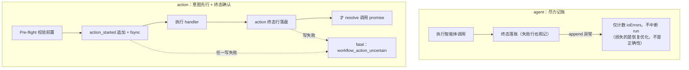

# 状态流水与故障恢复

本文介绍 `builtin:workflow` 的确定性执行流水（Journaling）：账本如何记账、恢复时为何坚持前缀重放而非无序查表、Agent 与 Action 的不同失败语义，以及 Hub 重启后的两阶段恢复。所有机制位于插件引擎内（`engine/journal.ts` 与 `engine/runtime.ts`）。

## 账本布局与事件契约

每个工作流 run 拥有专属 JSONL 账本，这是引擎的私有恢复资产（不是公开 API 数据形状，HTTP / CLI 客户端不得依赖其字段细节做重放决策）：

```
<Hub 数据目录>/plugins/builtin%3Aworkflow/artifacts/<conversationId>/workflow-<runId>.jsonl
```

默认数据目录下示例：`~/.helm/plugins/builtin%3Aworkflow/artifacts/42/workflow-wf_1a2b3c4d5e6f.jsonl`（`runId` 形如 `wf_<12位十六进制>`）。已保存的工作流脚本位于 `<插件数据目录>/workflows/`；运行索引与完整记录持久化在插件私有 `records` 文档（Hub 的 `state.sqlite` 插件文档表），Web 界面摘要经按会话分片的 `runs` 投影订阅。

每行一个 JSON 对象，三类事件行：

| `type` | 语义 | 关键字段 |
| :--- | :--- | :--- |
| `agent` | 智能体调用终态 | `index`, `key`, `ok`, `text`（成功时的回复文本）, `resumed?` |
| `action_started` | 动作执行意图（先于 handler 落盘） | `index`, `key`, `idempotent?` |
| `action` | 动作调用终态 | `index`, `key`, `ok`, `result` / `error`, `idempotent?` |

`index` 是调用发起位次（agent 与 action 共享同一全序，并发完成顺序不影响分配）；`seq` 是落盘物理单调序号（恢复时按 `index` 前缀校验、按 `seq` 去重）；`key` 是调用载荷的哈希摘要。

**Key 计算**（SHA-256，取 32 位十六进制）：agent 的 Key 覆盖 `prompt`、`label`、`model`、`agentType`、`effort`、`isolation`、`gate`、`resume`、`attachments`（原样序列化，不去重不排序——ID 或次序变化都是不同调用；未提供与空数组语义不同，不归一化）、`schema` 的序列化形式与 `maxSubagentDepth`（派工上限），采用带版本标记的固定槽 canonical 形态（新增字段只追加在版本号之后，杜绝槽位碰撞）。action 的 Key 覆盖全限定 `actionId` 与序列化后的输入。任何参数微调都会改变 Key，防止误用过期缓存。

## 前缀重放，不是查表缓存

恢复时引擎从第 0 位开始严格逐项匹配：调用位次 `index`、载荷哈希 `key`、调用类型（agent 槽位撞上 action 行视同失配）三项全等且终态 `ok` 才复用历史结果；遇到首个失配点立即断链，此后全部调用转为实时执行。

为什么不做「输入相同就复用」的无序查表？因为在编排流程里，上游环境变化意味着后续调用处于不同业务状态——另一场 run 第 12 位恰好相同的 prompt 不是同一份工作。乱序复用后续匹配，等同于在不同上下文中冒用历史结果。前缀单调匹配保证：只有当此前的每一步都确认与账本一致时，本步的历史结果才有资格被复用。

两类特殊失配的守卫：伪造或不一致的缓存行拒绝——`resumed` 标记必须与本次调用是否 resume 严格对应；重放命中的行若带 `schema`，还会用当前契约复检一次。前缀失配后命中「仅存在于账本缓存」的 resume 目标时显式失败（无活会话可续接，绝不伪造 live 续接）。

## Agent 尽力记账 vs Action 强一致

两类调用对账本的一致性要求完全不同。智能体推理的账本只是未来 resume 的优化，而外部动作有不可回滚的物理副作用（发消息、写数据、扣费）——后者必须先证明「可记账」才允许执行。



**Pre-flight 校验前置**：动作解析（未知动作、歧义短名）、插件启用状态、会话 scope 与 inputSchema 校验都发生在写入 `action_started` 之前。Pre-flight 失败时 handler 完全未执行（零副作用），引擎不写 `action_started`，只记一条幂等失败行（`ok: false, idempotent: true`）——避免参数拼写失误这类纯客户端错误把账本锁死为不可恢复。缓存复用分支同样受强一致约束：复用历史结果也要补记终态行，补记失败即 fatal（默默容忍会让新账本缺终态，下次 resume 无法复用而重执行副作用）。

**幂等承诺的边界**：`idempotent` 是动作作者（`PluginActionSpec.idempotent`）或脚本作者（`action(..., { idempotent: true })`）对「可安全重复执行（包括部分完成或中断状态下重试）」的主观承诺，不是引擎静态分析或动态检测所得。已声明幂等的动作，其悬挂 `action_started` 或失败终态行不触发不确定性拒绝；成功时前缀重放照常 100% 复用，失败或中断时允许 `resumeFromRunId` 放行并断链重跑。内建 `env.exec` 定义为非幂等。

**后缀非幂等断链保护**：重放严格保持前缀单调。当首次前缀失配、执行失败或缺行发生断链时，若旧账本剩余后缀中存在任何非幂等动作（无论成功、失败还是未完成），恢复以 `workflow_action_uncertain` 显式拒绝——自动转 live 重跑会重复执行外部副作用，此时只能开新 run 或人工确认后处理旧账本。

**agent 的弹性语义**：账本写入异常仅计数 `ioErrors` 供宿主诊断；重放不会命中失败的 agent 行，断点恢复时该节点重试。节点重试安全由任务作者自行保证——引擎不为智能体调用执行命令、写文件等副作用提供恰好一次承诺。

## 恢复时的不确定性判定

读取账本时，以下任一情形都无法证明「副作用未发生或已完整发生」，`readJournal` 置 `actionUncertain`：

| 触发情形 | 说明 |
| :--- | :--- |
| 悬挂非幂等意图行 | 存在 `action_started`（未标 `idempotent`）且无对应终态行——不论 `seq` 位置 |
| 损坏行无法判定类型 | 只有能从残余文本读出完整 `"type":"agent"` 前缀才归为 agent 行（计 ioError），其余一律保守 uncertain |
| 非幂等动作失败终态 | 存在 `ok: false` 且未标幂等的 action 行（handler 抛错不等于零副作用） |
| 文件不可读 | 权限或磁盘错误（`journal_read_failed`）；ENOENT 视为正常空账本 |

一旦判定 uncertain，恢复以 `workflow_action_uncertain` 显式拒绝并附账本路径与计数，禁止自动重跑，必须人工确认外部系统实际状态后，从账本移除对应 action 行或放弃 resume。所有失败或中断的动作为幂等时放行断链恢复，从该步起 live 重跑。

## Hub 重启两阶段恢复

插件服务生命周期分两个阶段，由宿主的统一启动屏障保证顺序（全部插件 `prepare` 完成后才开始 `start`）：

**阶段一 `prepareRecovery`（全局 prepare 屏障内）**：只读遗留记录，为仍在 `running` 状态的 subagent run 关联的子会话落持久 abort 标记——不唤醒 SDK 调度器、不提交任何输入。此刻其他插件的工具尚未注册完成，任何输入提交都会产生孤儿回合。

**阶段二 `init`（服务 start）**：终止遗留任务、把跨重启的 `running` run 显式标 `failed` 并附原因（workflow 记 `run interrupted by process restart（账本完好，可经 resumeFromRunId 恢复）`，subagent 记 `subagent run interrupted by process restart（可凭 conversationId/executionId 通过 resume 续接）`），经 outbox 补发父会话通知（`notifiedAt` 标记保证 at-least-once，不重复打扰）。此刻工具已注册，补发输入消费安全。

此后开发者可凭该 runId 安全续接：

```bash
# 从中断 run 恢复（省略 --conversation-id 时沿用原 run 的会话）
helm workflows run ./pipeline.js --resume-from-run-id wf_1a2b3c4d5e6f --wait

# subagent 类 run：不重放账本，改用 subagent resume 续接
# （凭 execution.conversationId / executionId）
```

恢复执行继承原 run 的 `args`（显式传入可覆盖），已成功前缀的智能体调用零 Token 瞬间返回，自中断点起实时接续。

## 边界与约束

- 账本字符串值落盘前经宿主统一脱敏（秘密替换为 marker）：重放只能取回脱敏值，机密传递应走 SecretStash 或节点环境预置，不能依赖重放还原。
- 同一 run 仍处 `running` 时不可恢复（`409 conflict`）；恢复目标会话与原 run 不一致以 `400 validation_error` 拒绝。
- 外部动作的副作用不承诺恰好一次：幂等承诺 + 意图先行 + 保守拒绝共同把风险收敛到「最多一次」与「显式失败」两种可处理状态，但不是分布式事务。
- 本机制不为智能体调用（含其工具执行）的副作用提供恰好一次保证；需要该强度的操作应建模为声明幂等的 `action`。
