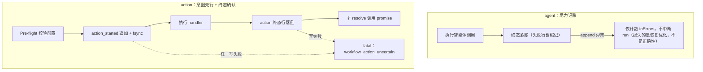

# 状态流水与故障恢复

本文面向需要理解工作流可靠性的读者：编写可恢复工作流的编排开发者（决定哪些步骤建模为幂等 `action`）、排查中断与续跑问题的维护者，以及评审副作用语义的设计者。内容覆盖 `builtin:workflow` 的确定性执行流水（journaling）：账本如何记账、恢复时为何坚持前缀重放而非无序查表、Agent 与 Action 的不同失败语义，以及 Hub 重启后的恢复边界。所有机制位于插件引擎内（`packages/plugins/src/workflow/engine/` 的 `journal*.ts` / `replay.ts` / `runtime.ts` / `service-recovery.ts`）。

## 账本布局与事件契约

每个工作流 run 拥有专属 JSONL 账本，这是引擎的私有恢复资产（不是公开 API 数据形状，HTTP / CLI 客户端不得依赖其字段细节做重放决策）：

```
<Hub 数据目录>/plugins/builtin%3Aworkflow/artifacts/<conversationId>/workflow-<runId>.jsonl
```

默认数据目录下示例：`~/.helmx/plugins/builtin%3Aworkflow/artifacts/42/workflow-wf_1a2b3c4d5e6f.jsonl`（`runId` 形如 `wf_<12 位十六进制>`）。运行索引（轻量字段：`id`、`conversationId`、`status`、`createdAt`、`updatedAt`、`notifyParentOnSettle`、`autoResumeCount`、`resumedByRunId`）持久化在插件私有 `records` 文档（Hub 的 `state.sqlite` 插件文档表）；每个 run 的完整记录经原子写（`.tmp` + `fsync` + `rename`）存为 `<插件数据目录>/artifacts/<conversationId>/workflow-<runId>.record.json`。Web 界面摘要经按会话分片的 `runs` 投影订阅；进度树中节点的 `prompt`、`gate.output` 与 `error` 只保留最多 1024 字符的截断预览，完整内容以子会话与账本为准。经 `workflow()` 嵌套的整棵工作流树共用同一份账本与本次运行的全局审计序号；恢复身份按各工作流的稳定 scope 路径与局部调用序号区分。

每行一个 JSON 对象，三类事件行：

| `type` | 语义 | 关键字段 |
| :--- | :--- | :--- |
| `agent` | 智能体调用终态（每次尝试各占一行） | `index`（本次尝试的独立位次）, `key`, `ok`, `text`（成功时的回复文本）, `attempt?`（尝试序号）, `invocationIndex?`（所属调用的首位次，并发下重试槽位按它对齐）, `prompt?`（本次尝试的实际提示词，已脱敏）, `error?`（失败原因，已脱敏）, `timedOut?`, `resumed?`, `skipped?`, `retryKind?: 'manual'`（人工控制台重试）, `execution?`（执行信息，含 worktree 描述）, `gate?`（`AgentGateResult`） |
| `action_started` | 动作执行意图（先于 handler 落盘） | `index`, `key`, `idempotent?` |
| `action` | 动作调用终态 | `index`, `key`, `ok`, `result` / `error`, `idempotent?` |

每行必须携带 `scopePath` 与 `scopeCallIndex`：前者由父工作流路径和嵌套调用的位置组成，后者是该 scope 内 agent/action 调用的发起序号。自动重试共用同一局部调用序号，以 `attempt` 区分。`parallel` 的每个分支和 `pipeline` 的每个 item 也有独立路径；同一 item 的各 stage 共用该路径。异步上下文负责把这些身份传到 agent/action，嵌套加载或模型完成的先后顺序不改变恢复身份。

`index` 是本次 run 内的全局尝试/动作位次，`invocationIndex` 用于把多次尝试折叠到同一进度节点；恢复时重新分配这些审计序号。`seq` 是落盘物理单调序号；`key` 是调用载荷的哈希摘要。缺少必需 scope 字段的账本不属于当前格式，不提供旧格式读取或迁移。

**Key 计算**（SHA-256，取 32 位十六进制）：agent 的 Key 覆盖 `prompt`、`label`、`model`、`agentType`、`effort`、`isolation`、`gate`、`resume`、`attachments`（原样序列化，不去重不排序——ID 或次序变化都是不同调用；未提供与空数组语义不同，不归一化）、`schema` 的序列化形式、`maxSubagentDepth`、`secretNames`（机密授予槽；DSL `agent()` 不支持该选项，此槽仅预留恒为空占位）与 `cwd`，采用带版本标记的固定槽 canonical 形态（新增字段只追加在版本号之后，杜绝槽位碰撞）。`timeoutMs` 与 `gateTimeoutMs` 只限制执行时限，不改变调用身份，不记入 Key；`maxAttempts` 的每次尝试各占一条独立 `index` 记录，不做归并。action 的 Key 覆盖全限定 `actionId` 与序列化后的输入。任何参数微调都会改变 Key，防止误用过期缓存。自动重试的失败原因先经宿主脱敏，再生成本次尝试的重试提示词（原文追加 `[attempt N failed]` 失败块）与 Key——重试提示词不同，每次尝试的 Key 也不同。

当前 Key 版本为 **v3**（固定槽 14 个，含 `cwd`）。无条件占位使每次版本变更后全部调用 Key 与旧账本失配——开发阶段无迁移，旧账本安全降级为断链重跑，不存在「未携带新字段则 key 不变」的兼容承诺。不符合当前契约的开发账本应清理后新建运行。

## 前缀重放，不是查表缓存

恢复时引擎在每个 scope 内按 `scopeCallIndex`、`attempt`、载荷哈希 `key` 与调用类型匹配。成功终态复用历史结果；可识别的失败尝试沿 `attempt` 链还原重试进度。首次失配会使该 scope 及其后续子 scope 断链；兄弟 scope 保持各自的前缀，因此并发模块 B 失败不会让已完成的模块 A 重跑。每次转入实时执行前仍检查未复用的非幂等动作，存在副作用风险则显式拒绝。

为什么不做「输入相同就复用」的无序查表？因为在编排流程里，上游环境变化意味着后续调用处于不同业务状态——另一场 run 第 12 位恰好相同的 prompt 不是同一份工作。乱序复用后续匹配，等同于在不同上下文中冒用历史结果。每个 scope 的前缀单调匹配保证：只有当前 scope 的前序调用仍匹配时，历史结果才可复用。父 scope 断链后，后续子 scope 也不能冒用旧结果。同一 scope 的调用发起顺序须确定；各 scope 之间的并发结算顺序可以改变。

两类特殊失配的守卫：伪造或不一致的缓存行拒绝——`resumed` 标记必须与本次调用是否 resume 严格对应；重放命中的行若带 `schema`，还会用当前契约复检一次。前缀失配后命中「仅存在于账本缓存」（无原生 `conversationId` 持久会话句柄或属于外部运行时 `executionId`）的 resume 目标时显式失败，绝不伪造 live 续接；若重放命中的原生 `agent({ label })` 行携带持久子会话句柄（`execution.conversationId` 且无外部 `executionId`），引擎会保留其 `resumeRef`，后续未落账的 `agent({ resume: label })` 可跨 `resumeFromRunId` 直接续接该原生子会话。

重放命中 `agent` 行时，`agent.withMeta` 与 `goal` 从账本还原该行的 `execution`（含 Worktree 描述）与 `gate` 字段，脚本可继续对该 Worktree 执行合入或清理。多级工作流的 `label` 以 `${scopeId}:${label}` 登记（见 [DSL 手册](dsl-guide.md)的 `workflow()` 一节）：同名 `label` 在不同子工作流内是不同节点，前缀匹配按各自的 Key 逐项比对，整棵树对根 `runId` 一次续跑。

**尝试链的重放**：`maxAttempts` 的每次尝试各占一条独立 `index` 行；恢复使用同一 `scopePath + scopeCallIndex` 下的 `attempt` 链匹配，进度树按本次 run 的 `invocationIndex` 折叠节点。重试句柄使用稳定调用身份，不依赖上一次 run 的全局序号。账本终态齐全时整份重放零执行：已成功的尝试直接复用结果；进程重启后从最后一次尝试继续——已失败的尝试行按 `attempt` 链重放登记，下次尝试从最后失败处续接同一子会话。目标已耗尽 `maxAttempts` 后，若原 run 已完成，或脚本随后仍执行了同一 scope 内的其他调用，重放如实回放失败（`goal` / `agent.withMeta` 得到 `ok: false` 与最后一次 `error`），保留既有后续结果。若原 run 为 `failed`，且该目标是其 scope 的末尾失败调用，新 run 会给它新的 `maxAttempts` 次执行预算，沿原句柄继续；历史失败不消耗新预算，`attempt` 与返回的 `attempts` 累计计数——例如历史两次失败，恢复首次成功即为第 3 次尝试。未配置重试（默认 `maxAttempts: 1`）的失败行不作为成功前缀，断链后转 live 重试。只有带执行句柄（`execution.conversationId` / `executionId`）的失败行才能作为续接锚点，无句柄的失败不可续接。

## Agent 尽力记账 vs Action 强一致

两类调用对账本的一致性要求完全不同。智能体推理的账本只是未来 resume 的优化，而外部动作有不可回滚的物理副作用（发消息、写数据、扣费）——后者必须先证明「可记账」才允许执行。



**Pre-flight 校验前置**：动作解析（未知动作、歧义短名）、插件启用状态、会话 scope 与 inputSchema 校验都发生在写入 `action_started` 之前。Pre-flight 失败时 handler 完全未执行（零副作用），引擎不写 `action_started`，只记一条幂等失败行（`ok: false, idempotent: true`）——避免参数拼写失误这类纯客户端错误把账本锁死为不可恢复。缓存复用分支同样受强一致约束：复用历史结果也要补记终态行，补记失败即 fatal（默默容忍会让新账本缺终态，下次 resume 无法复用而重执行副作用）。

**幂等承诺的边界**：`idempotent` 是动作作者（`PluginActionSpec.idempotent`）或脚本作者（`action(..., { idempotent: true })`）对「可安全重复执行（包括部分完成或中断状态下重试）」的主观承诺，不是引擎静态分析或动态检测所得。已声明幂等的动作，其悬挂 `action_started` 或失败终态行不触发不确定性拒绝；成功时前缀重放照常复用，失败或中断时允许 `resumeFromRunId` 放行并断链重跑。内建 `env.exec` 定义为非幂等。

**后缀非幂等断链保护**：当前 scope 断链时，若其后续调用或子 scope 中仍有未复用的非幂等动作，恢复以 `workflow_action_uncertain` 显式拒绝。已经补记并复用的动作不重复执行；兄弟 scope 的动作不受另一个模块失败影响。父 scope 变化仍会检查后代动作；分支断链也会检查祖先中未复用的后续动作。未知 scope 可能由脚本移动调用位置产生，存在未复用非幂等动作时显式拒绝，避免把位置变化当成全新安全调用。

**agent 的弹性语义**：账本写入异常仅计数 `ioErrors` 供宿主诊断。默认 `maxAttempts: 1` 的失败调用在恢复时断链转 live；自动重试的失败尝试按尝试链重放，人工 retry 与 skip 也保留原决定。节点重试安全由任务作者自行保证——引擎不为智能体调用执行命令、写文件等副作用提供恰好一次承诺。

## 恢复时的不确定性判定

读取账本时，以下任一情形都无法证明「副作用未发生或已完整发生」，`readJournal` 置 `actionUncertain`：

| 触发情形 | 说明 |
| :--- | :--- |
| 悬挂非幂等意图行 | 存在 `action_started`（未标 `idempotent`）且无对应终态行——不论 `seq` 位置 |
| 损坏行无法判定类型 | 单条损坏但能从残余文本读出完整 `"type":"agent"` 或 `"type":"agent_started"` 前缀的候选行计 `ioError` 后跳过（诊断暴露、不阻断其余行重放）；其余（含可解析但形状未知的行）一律保守 uncertain |
| 非幂等动作失败终态 | 存在 `ok: false` 且未标幂等的 action 行（handler 抛错不等于零副作用） |
| 序号冲突 | 相同 `seq` 对应不同记录，无法安全去重；版本或序号字段非法的 action 行也显式拒绝恢复 |
| 文件不可读 | 权限或磁盘错误（`journal_read_failed`）；ENOENT 视为正常空账本 |

一旦判定 uncertain，恢复以 `workflow_action_uncertain` 显式拒绝并附账本路径与计数，禁止自动重跑，必须人工确认外部系统实际状态后，从账本移除对应 action 行或放弃 resume。所有失败或中断的动作为幂等时放行断链恢复，从该步起 live 重跑。

## Hub 重启恢复

默认开启重启无感原位恢复（配置 `autoRecoverOnRestart`，默认 `true`；`false` 或环境变量 `HELMX_AUTO_RECOVER=0` 时回退中止收敛模式）：

**优雅关停（`ctx.host.isClosing === true && effectiveAutoRecover`）**：引擎调用 `workflows.suspend()`——终止进程内 Worker 与本地等待句柄，**不**调用 `abortConversationGuarded`、**不**改写终态、**不**触发 `onRunSettled` / 父会话通知，对在途 `RunRecord` 落盘 `suspendedCleanly: true`（保持 `status: 'running'`）并维持 Worktree `running` 租约 fail-closed 保留。单插件停用（`ctx.host.isClosing === false`）或关闭自动恢复时完整保留既有 `close()` 中止落盘 `aborted` 语义。

**阶段一 `prepareRecovery`（全局 prepare 屏障内）**：扫描全部 `pendingChildCleanup === true` 的已终态记录，以及（当自动恢复关闭、或运行触发 `crashRecoveries > 3` 熔断 / `actionUncertain` / `secret_grant_expired_on_restart` 不可原位恢复时）对应 `running` 记录的遗留子会话，经 `abortConversationGuarded` 落持久 abort 标记；可原位恢复的健康 `running` 记录不中止子会话，保留给 `harness.resume()` 与原位重挂。

**阶段二 `init`（服务 start）**：
- 若 `suspendedCleanly === true`：清除标记且不递增 `crashRecoveries`；若为异常崩溃（无 `suspendedCleanly`）：先递增 `crashRecoveries` 并落盘，`crashRecoveries > 3` 时触发 `[crash_recovery_limit]` 熔断（守卫中止子会话并标 `failed`）；
- 健康后台单子代理（`kind === 'subagent'`）：若崩溃于 `onResolved` 前且 `subagentSpec.hadSecretGrant === true`（内存机密已失效），诚实标 `failed (secret_grant_expired_on_restart)`；否则凭原 `runId`、`requestId` 与 `reattach` 原位重挂（原生 `conversationId` 于 `harness.resume()` 前同步等待 `onResolved` 就位结构化输出与 Worktree 租约，外部 `executionId` 于 `runtime.started` 放行）；
- 健康 DSL 工作流：沿用原 `runId` 启动 Worker，以 `initialSeq = maxExistingSeq + 1`、`inPlaceResume: true` 追加打开原账本（已落盘终态 0 Token 重放且不重复追加），遇到未配对终态的 `agent_started` 行时以原 `requestId` + `reattach` 原位重挂完成后继续执行；
- `subagent` 与 `SubagentWorkflow` 模型工具均声明 `replay: 'safe'` 并按受信 `(conversationId, callId)` 幂等重放，重启恢复 `ToolTask` 时继续等待原 run 或直接返回终态结果，不重复派生。
- 已达成终态且未发送父会话汇报的后台运行仍由 outbox 补发（`notifiedAt` 防重复）。

**阶段三 `runtime.started`（`harness.resume()` 后启动收尾）**：放行外部运行时与 pre-resolve 重挂，等待待收敛的遗留子会话结算至 `idle`（`awaitPreparedChildrenSettled`），随后回收可证明已停止的原生 Worktree 崩溃租约（外部 `executionId` 租约与活跃重挂租约保持 fail-closed 保留）。

对于已因重启熔断或历史原因处于 `failed` 的任务，开发者可单条或批量续跑：

```bash
# 从单条 failed/aborted 工作流或具句柄的单子代理恢复
pnpm helmx workflows run ./pipeline.js --resume-from-run-id wf_1a2b3c4d5e6f --wait

# 批量续接当前会话或全局全部可恢复的失败工作流与后台单子代理（不可恢复项记入 skipped）
pnpm helmx workflows resume-failed --current
pnpm helmx workflows resume-failed --all
```

恢复执行继承原 run 的 `args`（显式传入可覆盖），已成功前缀的智能体调用零 Token 瞬间返回，自中断点起实时接续。

## 失败 run 的自动断点续跑

上游模型接口长时间故障时，后台运行的 workflow run 可能用完重试次数变为 `failed`。`builtin:workflow`（默认启用）在每次 `diagnostics.collect` 巡检事件中上报满足以下全部条件的 run 为待续跑候选：

- `status === 'failed'` 且 `notifyParentOnSettle === true`（后台任务）；
- 未被新 run 接替（`resumedByRunId` 为空）；
- 失败原因不是语法错误、参数校验错误或 `workflow_action_uncertain`；
- 账本无不确定副作用，且至少有一条成功记录，或有一条带原生子会话句柄的失败尝试记录；
- 累计自动续跑次数 `autoResumeCount` 小于 3。

候选扫描遇到单条 run 记录损坏或文件缺失时，输出含 run ID 的诊断并跳过该条，保留其他健康候选；面向用户的 `listRuns` 仍显式报错。索引本身的形状损坏以 `workflow_index_corrupt` 拒绝读取、启动恢复和写入，不将损坏索引当空列表。

**消费方是 `builtin:superagent` 的巡检服务（默认停用）**：该插件未启用时自动续跑不发生，失败 run 保留 `failed` 终态等待人工 `--resume-from-run-id`。启用后，Watchdog 按巡检周期（15 秒一次）消费探针，按 `autoResumeCount` 等待冷却时间（第 0 次等 2 分钟，第 1 次等 5 分钟，第 2 次等 15 分钟），冷却期满调用 `workflow.run({ resumeFromRunId })` 从断点续跑，并把原 run 的 `resumedByRunId` 指向新 run 防止重复触发；新 run 的 `autoResumeCount` 在原值上递增。每轮巡检最多恢复 1 个 run，按 `failedAt` 从早到晚排序——网关刚恢复时避免同时唤醒多个大工作流再次压垮接口。人工续跑与自动续跑走同一入口，末尾失败目标按新恢复轮获得重试预算；成功兄弟节点继续复用；自动机制只额外限制冷却与续跑次数。

## 边界与约束

- 账本字符串值落盘前经宿主统一脱敏（秘密替换为 marker）：重放只能取回脱敏值，机密传递应走 SecretStash 或节点环境预置，不能依赖重放还原。
- 同一 run 仍处 `running` 时不可恢复（`409 conflict`）；恢复目标会话与原 run 不一致以 `400 validation_error` 拒绝。
- 外部动作的副作用不承诺恰好一次：幂等承诺 + 意图先行 + 保守拒绝共同把风险收敛到「最多一次」与「显式失败」两种可处理状态，但不是分布式事务。
- 本机制不为智能体调用（含其工具执行）的副作用提供恰好一次保证；需要该强度的操作应建模为声明幂等的 `action`。
