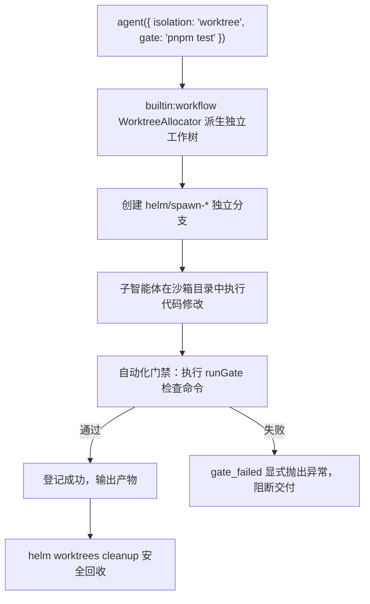
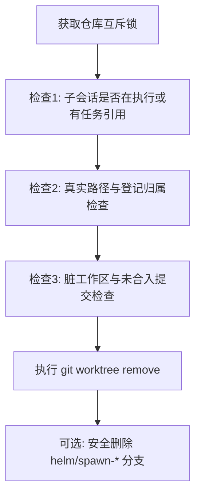

# Git Worktree 与代码门禁

本文介绍 Helm 代码沙箱隔离、自动化门禁验收与安全清理机制。

---

## 为什么需要沙箱隔离

多智能体编写代码时面临两大风险：

1. **工作区污染**：不同智能体并发修改同名文件产生冲突。
2. **代码丢失风险**：直接在开发工作区写代码可能覆盖未提交改动。

Helm 提供基于 Git Worktree 的物理代码沙箱与自动化门禁保障：



---

## Git Worktree 隔离机制

在编排 DSL 中声明 `isolation: 'worktree'` 即可启用独立代码沙箱：

```javascript
const result = await agent("重构认证模块并补齐单测", {
  label: "认证重构",
  isolation: "worktree",
  gate: "pnpm test packages/auth",
})
```

### 1. 主工作树权威解析

受管工作树由 `builtin:workflow` 插件的 WorktreeAllocator 负责（完整租约、续接与安全清理均在该插件内，不在内核）。
分配前调用 `git worktree list --porcelain -z` 获取仓库权威清单。
首条记录即为仓库真正的主工作树根目录。
即使调用方当前处于已有的 Worktree 中，算法依然能精准定位主根。
这彻底避免了目录猜根失误与嵌套创建目录的问题。

### 2. 独立目录与基线分支

WorktreeAllocator 在主工作树同级目录创建隔离环境：

- **目录路径**：`.helm-worktrees/<repo>-<shortId>`。
- **分支命名**：`helm/spawn-<shortId>`。
- **基线锚定**：分支基于当前实际提交 `baseCommit` 创建。
- **源状态记录**：如实记录源工作区的脏状态标记 `dirtySource`。

### 3. 跨平台同构执行

所有 Git 操作通过 `EnvFabric` 节点通道执行。
命令参数直接使用数组传递，无需拼接 Shell 字符串。
这种机制消除了参数注入风险，在 Linux、macOS 与 Windows 保持一致。

### 4. 元数据登记

分配成功后，元数据持久化存入 `builtin:workflow` 插件的文档存储（不再依赖内核私有存储）：

| 属性 | 类型 | 说明 |
| :--- | :--- | :--- |
| `id` | `string` | 唯一标识符，格式为 `${nodeId}:${path}` |
| `nodeId` | `string` | 目标节点标识符 |
| `repoRoot` | `string` | 仓库主工作树根目录绝对路径 |
| `path` | `string` | 分配的工作树绝对路径 |
| `branch` | `string` | 创建的独立分支名称 |
| `baseCommit` | `string` | 派生时的基线提交哈希 |
| `dirtySource` | `boolean` | 派生时主工作区是否包含未提交修改 |
| `status` | `'active' \| 'removed'` | 工作树当前生命周期状态 |

> [!SECURITY]
> 若路径或分支名称中包含系统已登记的机密信息，插件拒绝落库。
> 系统抛出异常并输出脱敏后的诊断日志。

---

## 代码门禁 (Gate) 机制

代码门禁是验证智能体产出有效性的核心机制。
未经门禁检验的代码绝不标记为执行成功。

### 1. 恰好一次执行设计

门禁执行严格遵循恰好一次原则：

1. **原生执行环境**：在子智能体所在工作树内执行 `runGate`。
2. **外部执行环境**：在远程窗格对应工作目录中执行门禁命令。
3. **结果回传**：执行环境通过 `onGateResult` 回报验证结果。
4. **宿主兜底**：若执行环境未回报结果，触发宿主 `runGate` 补跑。
5. **拒绝静默放行**：宿主缺少 `runGate` 能力时显式抛出异常。

### 2. 门禁验证语义

门禁命令必须退出码为 0 且在时限内完成：

```javascript
await agent("修复类型异常", {
  gate: "pnpm typecheck",
})
```

- 若命令返回非零退出码，系统将任务判定为 `gate_failed`。
- 执行日志会完整捕获门禁输出，便于定位代码缺陷。
- 确定性账本不会将门禁失败的调用视为成功结果。

---

## 安全回收机制与防丢代码保障

工作树完成使命后需要安全回收。
直接调用系统级删除可能导致丢失成果或损坏仓库。
Helm 内置了多重防护机制。

### 1. 仓库级串行互斥锁

每个 Git 仓库的 `git common-dir` 维护独立的互斥锁。
即使多个并发智能体同时请求清理同仓的不同工作树，也会按序串行执行。
这有效避免了并发竞争 `.git/config.lock` 导致的锁冲突。

### 2. 清理前严格检查链

清理操作在获取互斥锁后执行四道严格检查：



1. **占用检查**：关联子会话处于执行中，或有任务引用该路径时拒绝清理。
2. **根目录保护**：严格禁止清理仓库的主工作树。
3. **软链接防逃逸**：通过 `realpath` 检查，拒绝跨目录软链接跳跃。
4. **脏工作区保护**：检查是否存在未提交代码。
5. **未合并保护**：检查分支提交是否已合入主工作树 HEAD。

> [!CAUTION]
> 存在未提交修改或未合并提交时，默认拒绝删除。
> 必须显式传入强制标记 `force` 才会执行物理删除。

### 3. 分支安全删除策略

清理时可选择是否同步删除 Git 分支：

- 仅允许删除以 `helm/spawn-` 或 `helm/wf-` 开头的受管分支。
- 严禁删除开发者的个人分支或主干分支。
- 若工作树已删除但分支删除失败，系统保留记录供后续重试。

### 4. 节点文件互斥的边界

内核 `EnvFabric` 提供按 `nodeId + canonicalPath` 为目标的文件互斥：读-改-写（RMW）序列在同一目标上串行化，防止两个受管工具并发改写同一文件。

该互斥只约束经过 EnvFabric 的受管操作：同步 Shell 命令与外部编辑器直接写文件，不受它保证。并发场景中不要假设文件互斥能阻止进程外的写入。

---

## 工作树管理与清理指令

开发者可通过 CLI 或模型工具管理工作树。清理能力由 `builtin:workflow` 插件提供（默认启用；停用后 `helm worktrees cleanup` 命令与 `cleanup_worktree` 工具一并消失）。

### 1. CLI 清理命令 (`helm worktrees cleanup`)

命令行支持三种互斥选择器定位工作树：

```bash
# 1. 按受管工作树登记 ID 清理（node:path 形式）
helm worktrees cleanup --worktree-id local:/workspace/repo/.helm-worktrees/repo-abc

# 2. 按关联子会话 ID 清理
helm worktrees cleanup --conversation-id 42

# 3. 按绝对路径与目标节点清理
helm worktrees cleanup --path /workspace/repo/.helm-worktrees/repo-abc --node-id local
```

#### 进阶清理选项

- `--delete-branch`：清理工作树的同时删除对应的 Git 分支。
- `--force`：强制清理，允许删除脏工作区与未合入代码（不可越过占用、归属与 locked 校验）。

```bash
# 强制清理并删除对应分支
helm worktrees cleanup --conversation-id 42 --delete-branch --force
```

### 2. 智能体清理工具 (`cleanup_worktree`)

`builtin:workflow` 插件向智能体暴露原子工具 `cleanup_worktree`。
智能体可以在编排任务收尾时自行清理临时环境。
工具调用完全复用上述安全检查链，保障仓库安全。
