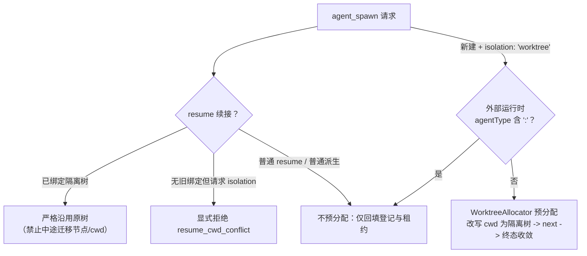
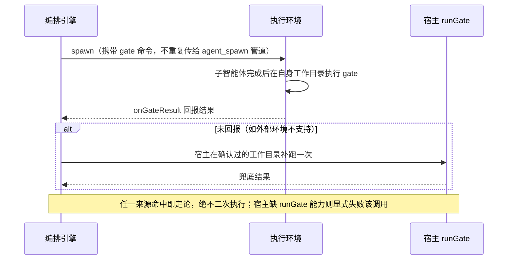

# Git Worktree 与代码门禁

本文介绍 `builtin:workflow` 插件的代码沙箱机制：`WorktreeIsolation` 如何经 `agent_spawn` 钩子包裹每一次派生、Gate 如何做到恰好一次验收、以及清理链如何在不丢代码的前提下安全回收工作树。机制全部位于 `builtin:workflow` 插件内（`isolation.ts` 与 `worktree.ts`），内核不参与。

## WorktreeIsolation：经 agent_spawn 包裹的隔离生命周期

插件在 `agent_spawn` 管道上挂载一个 priority 200 的 around（continuation）钩子。priority 数值越大越外层：它先于外部运行时接管器（如 `builtin:herdr` 的 priority 100）执行，因此无论是原生派生还是 Herdr 等外部运行时的执行，都同样被租约与登记包裹。钩子只对两类派生介入，其余零开销透传：



原生分配路径（`isolation: 'worktree'` 且非外部运行时）的完整时序：先经 `resolveSpawnTarget` 解析真实最终节点（显式 profile 绑定节点 > 父会话节点 > `local`），再在目标节点对源 `cwd` 执行 Git 派生，把最终请求的 `cwd` 改写为隔离树并清除 `isolation` 标记后调 `next` 进入真实执行链。

### 分配细节

主工作树以 Git 权威清单定位：执行 `git worktree list --porcelain -z` 取首条登记即主工作树根目录——即使派生时已处于某个隔离 worktree 内，也总能定位到真正主仓，绝不以 `dirname` 猜根，也不会嵌套出 `.helm-worktrees/.helm-worktrees`。隔离目录建在主工作树同级：

- 目录：`<主仓同级>/.helm-worktrees/<repo>-<shortId>`
- 分支：`helm/spawn-<shortId>`，基于分配时刻记录的 `baseCommit` 创建（不追易变 HEAD——锁内创建瞬间主仓 HEAD 可能已被推进）
- 源状态：如实记录源工作区是否脏（`dirtySource`）。源仓库脏时明确告知：隔离树基于 HEAD 创建，不包含源工作区未提交的改动。
- 上下文注入：每次启动（新建与 `resume`）都向子代理提示词末尾注入 `<worktree_context>`，内容含 `worktreeId`、`path`、`branch`、`baseCommit`、`baseBranch`（若有）与 `dirtySource` 提示，并提醒子代理在结束回合前运行 `git add` 与 `git commit` 保持工作区干净。从干净仓库切出的子代理同样知道自己的分支与目录。

所有 Git 命令经 EnvFabric 节点通道以 argv 数组直跑（无 shell 拼接），路径含空格或特殊字符在 Linux、macOS 与 Windows 上同样安全。分配成功后元数据持久化在插件私有文档：

| 字段 | 说明 |
| :--- | :--- |
| `id` | 唯一标识，格式 `${nodeId}:${path}` |
| `repoRoot` / `path` / `branch` / `baseCommit` | 主仓根、隔离树路径、分支名、基线提交 |
| `baseBranch` | 创建 Worktree 时源目录检出的本地分支名（父模块分支；detached HEAD 时为空），供清理时判定已合入目标 |
| `parentWorktreeId` | 源目录本身是受管 Worktree 时记录其 ID，标识父子关系 |
| `dirtySource` | 派生时源工作区是否含未提交修改 |
| `conversationId` / `executionId` | 绑定的子会话与执行标识（onResolved 回填） |
| `origin` | `'native'`（引擎分配）或 `'external'`（外部运行时回传登记） |
| `status` | `'active'` / `'removed'`；`branchDeleted` 单独记录分支删除状态 |

外部运行时（`agentType` 含 `:` 的形态）不预分配——外部运行时自行决定隔离方式（如 Herdr 的 `worktree.create`）；插件只在其 `onResolved` 回传 worktree 时统一登记，使 cleanup 对两类记录一视同仁。

### durable 租约（fail-closed）

工作树占用采用持久租约保护，安全红线是「不能证明停止就不能清理」：

- **占位先于副作用**：`git worktree add` 执行之前，先在租约文档持久登记占位（`phase: 'pending'`）并落盘。进程在此之后崩溃，重启后该占位仍在——清理时无法证明没有执行启动，会以 `worktree_execution_unknown` 显式阻塞，交人工确认。
- **释放仅限确认停止的状态**：执行确认成功；执行确认从未启动（`next` 调用前就抛错，此时占位自身可证明无执行）；或原生子会话的回合以失败收场（门禁未过、回合超时、Schema 校验失败、被中止/取消）且宿主确认该会话已停止。第三种情形的判定仅覆盖原生子会话（`conversationId` 已回填且无外部 `executionId`）：释放本次运行租约，同时保留 Worktree 记录与子会话映射，供下一轮 `resume` 续接或后续 `cleanup_worktree` 清理，`resume` 成功完成时顺带清掉该登记下残留的旧租约。外部执行（Herdr 等远端进程）启动与否不可证明，失败或取消后仍保留租约 fail-closed。特别地，Herdr 窗格回合超时（`TimeoutError` 中止，区别于普通取消）只保存诊断并保留窗格，不关窗、不代发按键，也不承诺底层 CLI 已停止；后续 `resume` 在任何 prompt 发送前以权威 `agent.get` 复核，仅 `idle` / `done` 放行续接，`working` / `blocked` / `unknown` 或无法权威确认（含启动期超时后 `agent.start` 完成与否不确定）一律显式拒绝，不新建窗格、不重发 `agent.start`。
- **未知状态保留租约**：进程崩溃后重启（无法证明子代理是否还在改文件）、`onResolved` 失败、外部进程可能已启动但未回填标识，均保留租约并以 `worktree_execution_unknown` 阻塞清理，交人工确认。
- **元数据机密检查**：将要落库的路径/分支/仓路径字段若包含已登记机密，以 `worktree_metadata_secret` 拒绝持久化（诊断输出使用脱敏值）。

resume 与租约的交互：已绑定隔离树的子会话在 resume 时严格沿用原树——目录缺失经节点真实探测证实后显式失败（探测失败与目录缺失严格区分，绝不把节点离线当作缺失）；中途迁移节点或改写 `cwd` 显式拒绝（`resume_cwd_conflict`）。创建时未启用隔离的会话，不允许在 resume 时中途切换为 worktree 隔离。

## Gate：恰好一次验收

`gate` 是验收子智能体产出的 shell 命令（如 `pnpm test`）。执行权在宿主，语义是恰好一次：



判定标准：退出码为 0 且未超时即通过；非零退出码或超时把该次 `agent` 调用判定为失败（节点状态记录 gate 输出，便于定位缺陷），确定性账本不会将门禁失败的调用记为成功结果。结果以 `AgentGateResult` 完整回传，字段固定为：

| 字段 | 类型 | 说明 |
| :--- | :--- | :--- |
| `ok` | `boolean` | 退出码为 0 且未超时 |
| `output` | `string` | 聚合输出（已脱敏） |
| `exitCode` | `number \| null` | 进程退出码；超时被杀时为 `null` |
| `timedOut` | `boolean` | 是否超时 |

宿主执行的门禁有独立超时：`agent()` 的 `gateTimeoutMs` 选项（`1_000 .. 600_000` 整数，默认 `120_000` 毫秒）传给宿主 `runGate`。超时由宿主终止整个进程组（先 SIGTERM，宽限后 SIGKILL），返回 `timedOut: true` 与 `exitCode: null`。门禁未过时抛出的 `gate_failed` 错误在 `details` 中附带 `exitCode`、`timedOut` 与输出尾部，供失败重试时定位缺陷。

宿主自跑 fallback 的工作目录只使用引擎确认过的值（执行环境回传的 `cwd` 或父会话 `cwd`），绝不猜测远端目录；宿主缺 `runGate` 能力则显式失败该调用。外部执行环境（如 Herdr 远端窗格）在其对应工作目录中执行同一命令并经 `onGateResult` 回报，回报优先采纳。`gateTimeoutMs` 只约束宿主侧执行；外部运行时是否支持门禁超时以其自身能力为准——当前 `builtin:herdr` 明确不支持：其本机 gate 依赖契约 `runLocalGate` 与远端 `transport.runGate` 均未暴露门禁超时参数，无法如实兑现超时语义，因此携带 `gateTimeoutMs` 的 Herdr 运行时请求（新建与已登记 resume）在进入建窗/续接前以 `unsupported_runtime` 显式拒绝（原生执行行不受影响）；需要限时验收时请在 `gate` 命令内自行包装超时（如 `timeout <秒> <命令>`）。

## 安全回收

工作树完成使命后需要回收，但直接删除可能丢掉未合入的成果。清理链的设计目标：绝不误删人类目录、绝不丢失未合入代码、并发安全。

### 仓库级串行锁

每个 Git 仓库以 canonical `git common-dir` 真实路径为键维护进程内串行队列。同一仓库的不同 worktree 清理也按序串行，避免并发操作抢占 `.git/config.lock`。锁外先做占用快速失败检查，锁内再以最新记录复查一遍（并发清理与状态变更在锁内收敛到同一事实）。

### 六道清理安全检查

锁内重新取证权威 `git worktree list` 登记，并在移除前完成以下检查：

| 检查 | 拒绝错误码 | force 可否越过 |
| :--- | :--- | :--- |
| 1. 占用检查：关联子会话运行中（`working` / `blocked`），或路径仍被在途 spawn 执行 / 本插件租约引用 | `worktree_in_use` | 否 |
| 2. 主根保护：登记路径即主工作树，或经 realpath 解析指向主工作树 | `worktree_owner_mismatch` | 否 |
| 3. realpath 校验：登记路径经软链跳到其他工作树（登记可能已被替换）；附加权威登记的 path / branch / HEAD 归属匹配、prunable / locked 状态检查 | `worktree_owner_mismatch` / `worktree_locked` | 否 |
| 4. 进程占用保护：目标节点上的进程仍以工作树或其子目录为 cwd，或持有其中的文件句柄；探测不完整或不支持时同样拒绝 | `worktree_process_in_use` / `worktree_process_check_failed` | 否 |
| 5. 脏工作区保护：含未提交修改、未跟踪或被忽略文件（`--ignored=matching` 也计入） | `worktree_dirty` | 是（`force`） |
| 6. 未合入保护：分支存在相对基准提交未合入的提交（`git rev-list --count`） | `worktree_dirty` | 是（`force`） |

第 6 项检查的基准提交按以下顺序确定：

1. 调用方传入 `mergedInto`（动作输入或 CLI `--merged-into`）：校验其为合法 ref（非空、不含空白与控制字符、不含 `..` / `~` / `^` / `:`，不以 `-` 开头），在仓库内 `git rev-parse --verify --quiet "<ref>^{commit}"` 解析。解析不到提交以 `400 validation_error` 显式拒绝，不回退主工作树。
2. 未传 `mergedInto` 但登记了 `baseBranch`：父分支仍存在时用其当前提交；父分支已删则回退主工作树 HEAD。
3. 其他情况用主工作树当前 HEAD。

计数为 `0` 且工作区干净时，说明提交已全部合入目标分支，不传 `force` 即可删除。确认合入（或 `force`）后统一用 `git branch -D` 删除分支：基准提交不是 `main` 时 `git branch -d` 会拒绝删除，`-D` 避免误报。这套基准规则服务于父子 Worktree：模块分支 `B` 派生的子分支 `C` 已合入 `B`、而 `B` 尚未合入 `main` 时，清理 `C` 传入 `mergedInto: B` 即可正常回收，不需要 `force`。

第 3 道中的 `locked` 是所有者显式加锁，任何情况下不可越过（请先解锁）。检查命令本身失败（如 `git status` 报错）会以 `worktree_check_failed` 显式中止清理，绝不当作干净或目录缺失。全部通过后执行真实 `git worktree remove`；分支删除部分失败时先固化「树已 removed」事实（`branchDeleted: false` 与诊断保留在记录上），可再次 cleanup 传 `deleteBranch` 重试。

进程探测在实际目标节点执行，远端节点不可达时不会改查 Hub 本机。命中占用时，错误详情给出 PID、进程名和占用方式，不采集命令行或环境变量；框架只拒绝清理，不终止进程。调用方核对归属并完成自己的进程收尾后，可重试清理。

进程 exec 或退出期间可能短暂拒绝读取 `/proc`。当快照没有发现占用但不完整时，清理链最多额外复查两次；只有重新取得完整且零占用的快照才放行。发现实际占用时立即拒绝，快照持续不完整也继续拒绝（权限盲区不计入完整性判定，不触发复查），不凭等待时间推断进程已经退出。

当前探测只支持 Linux 的可见 `/proc` 视图。macOS、Windows 返回不支持，受管 worktree 自动清理因此拒绝。Linux 上扫描把「结构性盲区」与「扫描异常」按 errno 分开：持久的权限拒绝（EACCES/EPERM，经复核确认进程存活且重读仍拒）不论 uid 一律是权限不可观测的结构性盲区——跨 uid（如非 root Hub 读不了 root 属主进程的 cwd 或文件句柄），或 non-dumpable 进程（如 `systemd --user` 用户实例，属主自己也读不了自己的 `/proc/<pid>/cwd`；这是操作系统能力模型的结构性事实，不是扫描器异常，任何非 root 扫描方都会撞上）——计入快照的 `unobservable` 计数并在诊断中如实呈现，不影响完整性判定，不再阻塞清理；与 Hub 同 uid 的普通可转储进程（helm 自己派生的子代理、git、shell）永远可观测，保护面不受影响。非权限类读取异常（如 EIO）或扫描上限触发仍使快照不完整（`complete=false`），清理以 `worktree_process_check_failed` 拒绝。`force` 不跳过平台、权限或完整性检查。

这次探测是删除前的进程快照，不是跨进程的原子锁：扫描之后新进程仍可能进入该目录。需要交付的文件应先用 `register_artifact` 或 `helm artifacts put` 登记为产物。登记成功后，副本保存在 Helm 数据目录，源 worktree 清理不会删除副本；所属会话删除仍会级联删除产物。

分支删除只允许 `helm/spawn-` 与 `helm/wf-` 两个受管前缀，绝不触碰人类分支。目录已不存在的记录以 `worktree_missing` 显式报错并保留登记（节点真实 fs stat 证明缺失才算），绝不全仓 `prune` 其他登记。

### CLI 与模型工具

```bash
# 三种互斥选择器定位目标
helm worktrees cleanup --worktree-id local:/repo/.helm-worktrees/repo-ab12cd34
helm worktrees cleanup --conversation-id 42
helm worktrees cleanup --path /repo/.helm-worktrees/repo-ab12cd34 --node-id local

# 选项：--delete-branch 一并删除受管分支；--merged-into <ref> 指定已合入的
# 目标分支或提交（缺省用登记的 baseBranch，再回退主工作树 HEAD）；
# --force 越过脏工作区/未合入保护（不可越过占用、归属与 locked 校验）
helm worktrees cleanup --conversation-id 42 --merged-into helm/spawn-ab12cd34 --delete-branch
```

同一能力暴露为模型工具 `cleanup_worktree`（参数同构：`worktreeId` / `conversationId` / `path` + `nodeId` / `deleteBranch` / `mergedInto` / `force`），子智能体可在任务收尾时自行清理。CLI 旗标由动作 Schema 动态派生（camelCase 入参映射为 kebab-case 旗标），与工具参数一一对应；动作 Schema 新增入参即自动出现对应旗标，无需改 CLI 实现。工具侧的 `--current` 语义：无任何显式选择器时以当前会话为选择器（即子会话自己的 worktree），显式选择器永不被上下文覆盖。清理前还有一道租约终检：存在重启中断或未确认停止的执行租约时以 `worktree_execution_unknown` 拒绝（见上文 fail-closed 红线）。

## 边界与约束

- 插件停用期间工作树登记与租约不清除，重新启用后 cleanup 仍可定位（不丢元数据）；停用插件时在途运行经 `liveTasks` 阻止（`409 plugin_has_live_tasks`）。在途工作树占用不经宿主声明端口：cleanup 链直接以宿主在途 spawn 执行坐标与本插件 durable 租约判定（`isPathInUse`）。
- 内核 `EnvFabric` 另提供按 `nodeId + canonicalPath` 的文件互斥，但只约束经过 EnvFabric 的受管操作：同步 shell 命令与外部编辑器直接写文件不受它保证。
- 非常规仓库布局（裸仓库、`--separate-git-dir`）显式拒绝（`worktree_unsupported_layout`），不猜测主仓路径。
